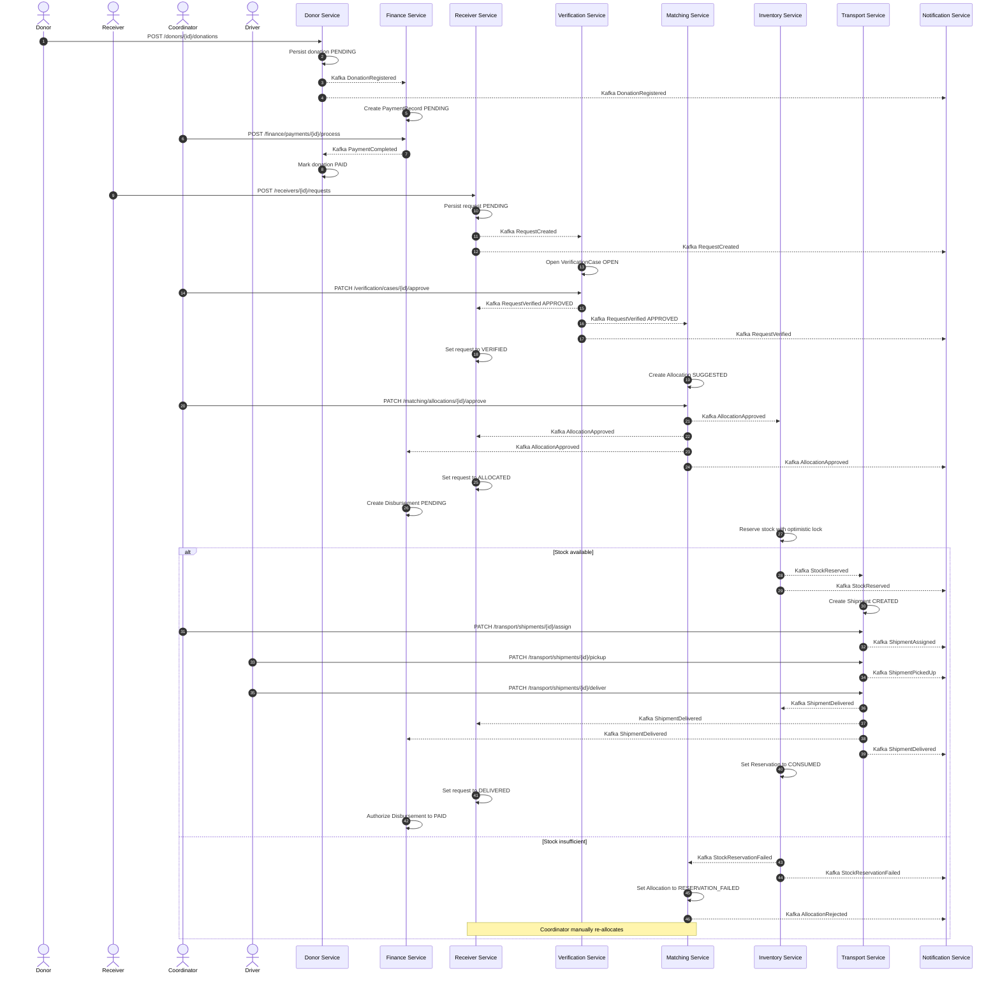
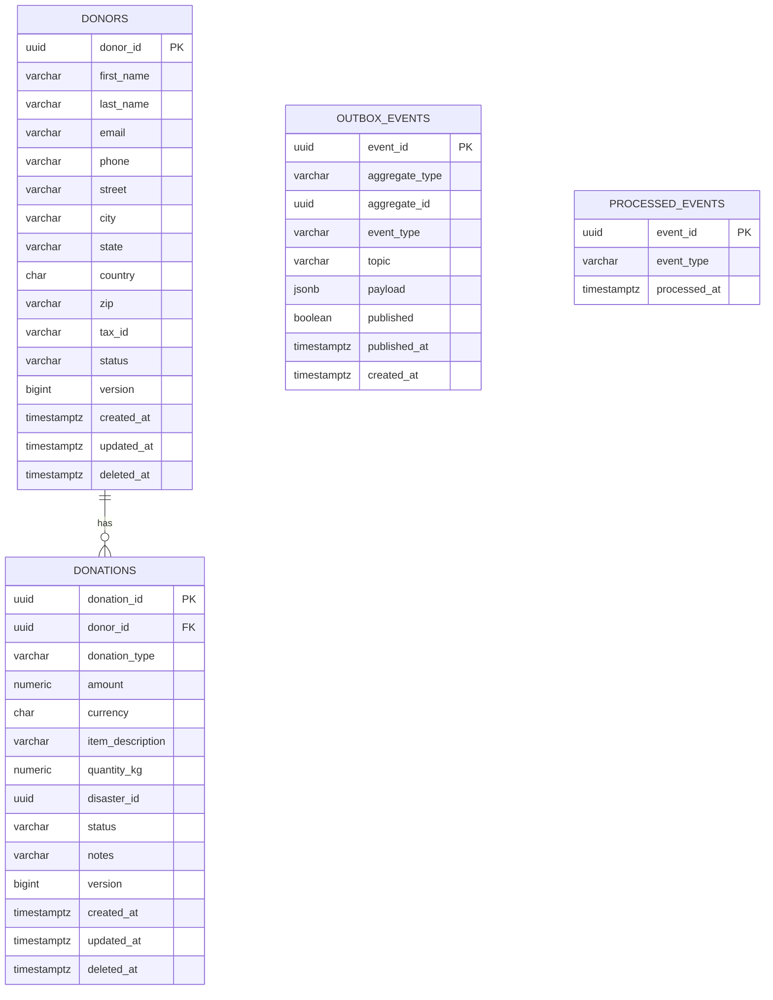
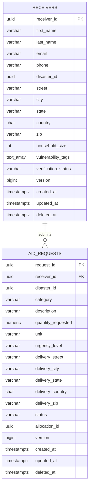
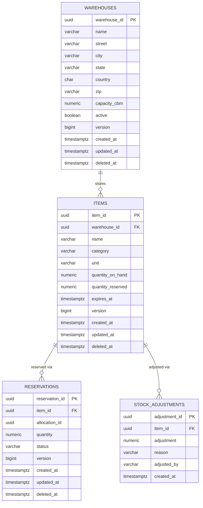
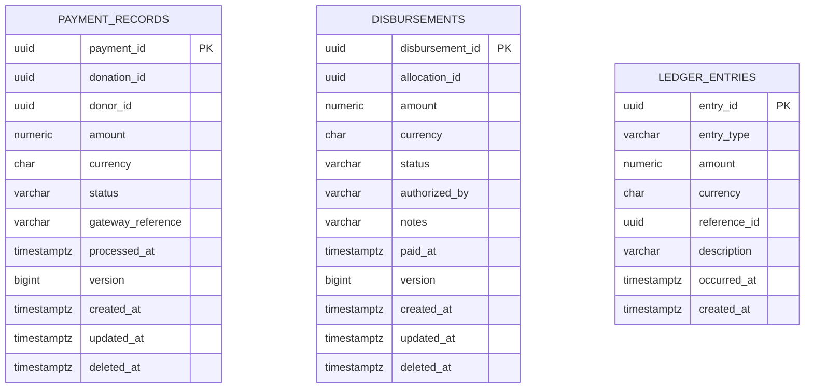
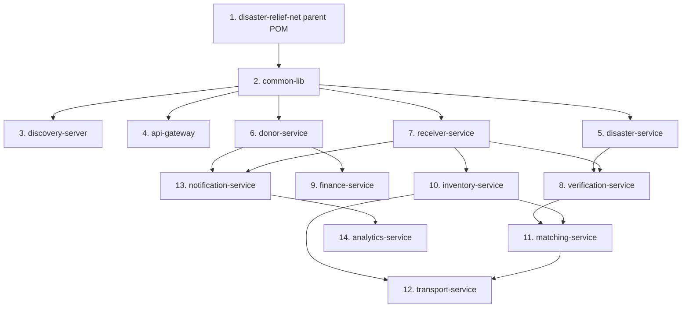

# DisasterReliefNet – Architecture Reference

> **Status:** Living document – single source of truth for all service names,
> topic names, event field names, endpoint paths, DTO fields, and database
> column names. Every subsequent code generation prompt must match this
> document exactly. Deviations require a documented amendment here first.

---

## Table of Contents

1. [System Overview](#1-system-overview)
2. [Infrastructure Services](#2-infrastructure-services)
3. [Domain Services](#3-domain-services)
   - 3.1 [Donor Service (8081)](#31-donor-service-8081)
   - 3.2 [Receiver Service (8082)](#32-receiver-service-8082)
   - 3.3 [Inventory Service (8083)](#33-inventory-service-8083)
   - 3.4 [Matching Service (8084)](#34-matching-service-8084)
   - 3.5 [Transport Service (8085)](#35-transport-service-8085)
   - 3.6 [Verification Service (8086)](#36-verification-service-8086)
   - 3.7 [Disaster Service (8087)](#37-disaster-service-8087)
   - 3.8 [Notification Service (8088)](#38-notification-service-8088)
   - 3.9 [Finance Service (8089)](#39-finance-service-8089)
   - 3.10 [Analytics Service (8090)](#310-analytics-service-8090)
4. [Kafka Event Catalogue](#4-kafka-event-catalogue)
5. [End-to-End Saga](#5-end-to-end-saga)
6. [Database Schemas](#6-database-schemas)
7. [Roles & Permission Matrix](#7-roles--permission-matrix)
8. [Mermaid Diagrams](#8-mermaid-diagrams)
9. [Build Order](#9-build-order)

---

## 1. System Overview

DisasterReliefNet is a **cloud-native, event-driven microservices platform**
that coordinates disaster relief supply chains. It connects:

| Actor | Role Token | Primary Service |
|---|---|---|
| Financial donors | `DONOR` | Donor Service |
| Disaster victims / aid recipients | `RECEIVER` | Receiver Service |
| Relief organisations / coordinators | `COORDINATOR` | Inventory, Matching |
| Delivery drivers | `DRIVER` | Transport Service |
| Platform administrators | `ADMIN` | All services |

**Core flow:**
```
Donor registers donation
  -> Receiver submits aid request
    -> Verification validates request
      -> Matching allocates inventory
        -> Finance approves allocation
          -> Inventory reserves stock
            -> Transport assigns shipment
              -> Driver delivers
                -> Finance reconciles
                  -> Analytics records
```

**Cross-cutting concerns:**

| Concern | Implementation |
|---|---|
| Auth | Keycloak (OAuth 2.1 + OIDC), JWT bearer tokens |
| Service discovery | Eureka (discovery-server:8761) |
| API ingress | Spring Cloud Gateway (api-gateway:8080) |
| Async messaging | Apache Kafka (topic-per-event-type) |
| Resilience | Resilience4j circuit breakers + retry on all Feign clients |
| Observability | Micrometer → Prometheus → Grafana |
| Config | Per-service `application.yml` with env-var overrides |
| Secrets | Never hardcoded; injected via env vars or Vault in prod |
| DB migrations | Flyway (per-service schema); `ddl-auto=validate` |

---

## 2. Infrastructure Services

### 2.1 Discovery Server — Port **8761**

| Item | Value |
|---|---|
| Spring Boot app name | `discovery-server` |
| Maven artifact | `com.disasterreliefnet:discovery-server` |
| Role | Eureka server. All domain services register here. |
| Key config | `eureka.client.register-with-eureka=false`, `eureka.client.fetch-registry=false` |
| Security | Basic auth (username/password from env vars `EUREKA_USER` / `EUREKA_PASS`) |
| Health endpoint | `GET /actuator/health` |

### 2.2 API Gateway — Port **8080**

| Item | Value |
|---|---|
| Spring Boot app name | `api-gateway` |
| Maven artifact | `com.disasterreliefnet:api-gateway` |
| Role | Spring Cloud Gateway. Performs JWT validation via Keycloak introspection, routes to downstream services, applies rate limiting (Redis token bucket), adds `X-Correlation-Id` header. |
| Route prefix pattern | `/api/v1/{service-name}/**` → `lb://{service-name}` |
| Rate limiting | 100 req/s per authenticated user (Redis); 20 req/s unauthenticated |
| CORS | Configured per `CORS_ALLOWED_ORIGINS` env var |
| Actuator | `GET /actuator/health`, `GET /actuator/gateway/routes` |

**Gateway Route Table:**

| Prefix | Downstream Service |
|---|---|
| `/api/v1/donors/**` | `lb://donor-service` |
| `/api/v1/receivers/**` | `lb://receiver-service` |
| `/api/v1/inventory/**` | `lb://inventory-service` |
| `/api/v1/matching/**` | `lb://matching-service` |
| `/api/v1/transport/**` | `lb://transport-service` |
| `/api/v1/verification/**` | `lb://verification-service` |
| `/api/v1/disasters/**` | `lb://disaster-service` |
| `/api/v1/notifications/**` | `lb://notification-service` |
| `/api/v1/finance/**` | `lb://finance-service` |
| `/api/v1/analytics/**` | `lb://analytics-service` |

---

## 3. Domain Services

### Conventions applied to every service

- **Spring Boot app name** = Maven `artifactId` (e.g., `donor-service`)
- **Base package** = `com.disasterreliefnet.{service-slug}` (e.g., `com.disasterreliefnet.donor`)
- **Package structure**: `controller`, `service`, `repository`, `domain`, `dto`, `mapper`, `config`, `exception`, `event`
- **Outbox table** = `outbox_events` — present in every service's schema
- **Processed-events table** = `processed_events` — present in every service's schema
- **All IDs**: `UUID` (PostgreSQL `uuid` type), generated with `UUID.randomUUID()`
- **All timestamps**: `Instant` mapped to PostgreSQL `timestamptz`
- **Audit columns**: `created_at`, `updated_at` on every table (managed by `@PrePersist`/`@PreUpdate`)
- **Soft delete**: `deleted_at timestamptz NULL` — queries filter `WHERE deleted_at IS NULL`
- **Optimistic locking**: `version bigint NOT NULL DEFAULT 0` on all mutable aggregate roots

---

### 3.1 Donor Service (8081)

**Purpose:** Manages donor profiles and monetary/in-kind donation registrations.
Produces `DonationRegistered` events. Integrates with Finance Service for
payment confirmations.

**Owned Entities:** `donors`, `donations`

**Kafka Producer Topics:** `donation.registered`

**Kafka Consumer Topics:** `payment.completed` (to mark donations as paid)

#### REST Endpoints

| Method | Path | Request DTO | Response DTO | Roles |
|---|---|---|---|---|
| `POST` | `/api/v1/donors` | `CreateDonorRequest` | `DonorResponse` | PUBLIC (self-registration) |
| `GET` | `/api/v1/donors/{donorId}` | — | `DonorResponse` | ADMIN, COORDINATOR, DONOR (own) |
| `PUT` | `/api/v1/donors/{donorId}` | `UpdateDonorRequest` | `DonorResponse` | ADMIN, DONOR (own) |
| `DELETE` | `/api/v1/donors/{donorId}` | — | `204 No Content` | ADMIN, DONOR (own) |
| `GET` | `/api/v1/donors` | `?page&size&sort` | `Page<DonorResponse>` | ADMIN, COORDINATOR |
| `POST` | `/api/v1/donors/{donorId}/donations` | `CreateDonationRequest` | `DonationResponse` | DONOR (own), ADMIN |
| `GET` | `/api/v1/donors/{donorId}/donations` | `?page&size` | `Page<DonationResponse>` | ADMIN, COORDINATOR, DONOR (own) |
| `GET` | `/api/v1/donors/{donorId}/donations/{donationId}` | — | `DonationResponse` | ADMIN, COORDINATOR, DONOR (own) |
| `PATCH` | `/api/v1/donors/{donorId}/donations/{donationId}/cancel` | — | `DonationResponse` | ADMIN, DONOR (own) |

#### DTOs

```
CreateDonorRequest {
  firstName: String @NotBlank @Size(max=100)
  lastName:  String @NotBlank @Size(max=100)
  email:     String @NotBlank @Email
  phone:     String @Pattern(regexp="^\\+?[1-9]\\d{1,14}$")
  address:   AddressDto
  taxId:     String @Size(max=50)            // optional
}

UpdateDonorRequest {
  firstName: String @Size(max=100)
  lastName:  String @Size(max=100)
  phone:     String @Pattern(regexp="^\\+?[1-9]\\d{1,14}$")
  address:   AddressDto
  taxId:     String @Size(max=50)
}

DonorResponse {
  donorId:   UUID
  firstName: String
  lastName:  String
  email:     String
  phone:     String
  address:   AddressDto
  taxId:     String
  status:    DonorStatus          // ACTIVE | SUSPENDED | DELETED
  createdAt: Instant
  updatedAt: Instant
}

AddressDto {
  street:  String @NotBlank
  city:    String @NotBlank
  state:   String @NotBlank
  country: String @NotBlank @Size(min=2,max=2)   // ISO 3166-1 alpha-2
  zip:     String @NotBlank
}

CreateDonationRequest {
  donationType:   DonationType    // MONETARY | IN_KIND
  amount:         BigDecimal      // required if MONETARY; @DecimalMin("0.01")
  currency:       String          // ISO 4217, required if MONETARY; @Size(min=3,max=3)
  itemDescription: String         // required if IN_KIND; @Size(max=500)
  quantityKg:     BigDecimal      // optional, for IN_KIND
  disasterId:     UUID            // optional -- earmark for specific disaster
  notes:          String @Size(max=1000)
}

DonationResponse {
  donationId:      UUID
  donorId:         UUID
  donationType:    DonationType
  amount:          BigDecimal
  currency:        String
  itemDescription: String
  quantityKg:      BigDecimal
  disasterId:      UUID
  status:          DonationStatus  // PENDING | CONFIRMED | CANCELLED | PAID
  notes:           String
  createdAt:       Instant
  updatedAt:       Instant
}
```

---

### 3.2 Receiver Service (8082)

**Purpose:** Manages beneficiary (disaster victim) profiles and aid requests.
Produces `RequestCreated` events. Consumes `RequestVerified` and
`AllocationApproved` events to reflect request status changes.

**Owned Entities:** `receivers`, `aid_requests`

**Kafka Producer Topics:** `request.created`

**Kafka Consumer Topics:** `request.verified`, `allocation.approved`,
`shipment.delivered` (to mark request fulfilled)

#### REST Endpoints

| Method | Path | Request DTO | Response DTO | Roles |
|---|---|---|---|---|
| `POST` | `/api/v1/receivers` | `CreateReceiverRequest` | `ReceiverResponse` | PUBLIC (self-registration) |
| `GET` | `/api/v1/receivers/{receiverId}` | — | `ReceiverResponse` | ADMIN, COORDINATOR, RECEIVER (own) |
| `PUT` | `/api/v1/receivers/{receiverId}` | `UpdateReceiverRequest` | `ReceiverResponse` | ADMIN, RECEIVER (own) |
| `DELETE` | `/api/v1/receivers/{receiverId}` | — | `204 No Content` | ADMIN |
| `GET` | `/api/v1/receivers` | `?page&size&disasterId` | `Page<ReceiverResponse>` | ADMIN, COORDINATOR |
| `POST` | `/api/v1/receivers/{receiverId}/requests` | `CreateAidRequestRequest` | `AidRequestResponse` | RECEIVER (own), COORDINATOR, ADMIN |
| `GET` | `/api/v1/receivers/{receiverId}/requests` | `?page&size&status` | `Page<AidRequestResponse>` | ADMIN, COORDINATOR, RECEIVER (own) |
| `GET` | `/api/v1/receivers/{receiverId}/requests/{requestId}` | — | `AidRequestResponse` | ADMIN, COORDINATOR, RECEIVER (own) |
| `PATCH` | `/api/v1/receivers/{receiverId}/requests/{requestId}/cancel` | — | `AidRequestResponse` | ADMIN, RECEIVER (own) |
| `GET` | `/api/v1/requests` | `?page&size&disasterId&status` | `Page<AidRequestResponse>` | ADMIN, COORDINATOR |

#### DTOs

```
CreateReceiverRequest {
  firstName:        String @NotBlank @Size(max=100)
  lastName:         String @NotBlank @Size(max=100)
  email:            String @Email
  phone:            String @Pattern(regexp="^\\+?[1-9]\\d{1,14}$")
  disasterId:       UUID   @NotNull
  currentLocation:  AddressDto @NotNull
  householdSize:    int    @Min(1)
  vulnerabilityTags: List<String>   // e.g. ["ELDERLY","DISABLED"]
}

UpdateReceiverRequest {
  phone:            String
  currentLocation:  AddressDto
  householdSize:    int @Min(1)
  vulnerabilityTags: List<String>
}

ReceiverResponse {
  receiverId:        UUID
  firstName:         String
  lastName:          String
  email:             String
  phone:             String
  disasterId:        UUID
  currentLocation:   AddressDto
  householdSize:     int
  vulnerabilityTags: List<String>
  verificationStatus: VerificationStatus  // UNVERIFIED | PENDING | VERIFIED | REJECTED
  createdAt:         Instant
  updatedAt:         Instant
}

CreateAidRequestRequest {
  disasterId:      UUID   @NotNull
  category:        AidCategory @NotNull   // FOOD | WATER | MEDICINE | SHELTER | CLOTHING | OTHER
  description:     String @NotBlank @Size(max=1000)
  quantityRequested: BigDecimal @DecimalMin("0.01")
  unit:            String @NotBlank @Size(max=20)  // "kg","boxes","litres"
  urgencyLevel:    UrgencyLevel @NotNull  // LOW | MEDIUM | HIGH | CRITICAL
  deliveryAddress: AddressDto @NotNull
}

AidRequestResponse {
  requestId:        UUID
  receiverId:       UUID
  disasterId:       UUID
  category:         AidCategory
  description:      String
  quantityRequested: BigDecimal
  unit:             String
  urgencyLevel:     UrgencyLevel
  deliveryAddress:  AddressDto
  status:           RequestStatus  // PENDING | VERIFIED | REJECTED | ALLOCATED | IN_TRANSIT | DELIVERED | CANCELLED
  allocationId:     UUID           // set after matching
  createdAt:        Instant
  updatedAt:        Instant
}
```

---

### 3.3 Inventory Service (8083)

**Purpose:** Manages warehouse stock of relief items. Handles stock reservation
and release. Produces `StockReserved` and `StockReservationFailed` events.
Consumes `AllocationApproved` to trigger reservation; `ShipmentDelivered` to
confirm stock consumed.

**Owned Entities:** `warehouses`, `items`, `stock_adjustments`, `reservations`

**Kafka Producer Topics:** `stock.reserved`, `stock.reservation.failed`

**Kafka Consumer Topics:** `allocation.approved`, `shipment.delivered`,
`donation.registered` (IN_KIND donations create stock entries)

#### REST Endpoints

| Method | Path | Request DTO | Response DTO | Roles |
|---|---|---|---|---|
| `POST` | `/api/v1/inventory/warehouses` | `CreateWarehouseRequest` | `WarehouseResponse` | ADMIN, COORDINATOR |
| `GET` | `/api/v1/inventory/warehouses` | `?page&size` | `Page<WarehouseResponse>` | ADMIN, COORDINATOR |
| `GET` | `/api/v1/inventory/warehouses/{warehouseId}` | — | `WarehouseResponse` | ADMIN, COORDINATOR |
| `PUT` | `/api/v1/inventory/warehouses/{warehouseId}` | `UpdateWarehouseRequest` | `WarehouseResponse` | ADMIN, COORDINATOR |
| `POST` | `/api/v1/inventory/items` | `CreateItemRequest` | `ItemResponse` | ADMIN, COORDINATOR |
| `GET` | `/api/v1/inventory/items` | `?page&size&category&warehouseId` | `Page<ItemResponse>` | ADMIN, COORDINATOR, DRIVER |
| `GET` | `/api/v1/inventory/items/{itemId}` | — | `ItemResponse` | ADMIN, COORDINATOR, DRIVER |
| `PUT` | `/api/v1/inventory/items/{itemId}` | `UpdateItemRequest` | `ItemResponse` | ADMIN, COORDINATOR |
| `POST` | `/api/v1/inventory/items/{itemId}/stock` | `AdjustStockRequest` | `ItemResponse` | ADMIN, COORDINATOR |
| `GET` | `/api/v1/inventory/reservations` | `?page&size&allocationId` | `Page<ReservationResponse>` | ADMIN, COORDINATOR |
| `GET` | `/api/v1/inventory/reservations/{reservationId}` | — | `ReservationResponse` | ADMIN, COORDINATOR |
| `DELETE` | `/api/v1/inventory/reservations/{reservationId}` | — | `204 No Content` | ADMIN, COORDINATOR |

#### DTOs

```
CreateWarehouseRequest {
  name:     String @NotBlank @Size(max=200)
  address:  AddressDto @NotNull
  capacity: BigDecimal @DecimalMin("0")   // cubic meters
}

UpdateWarehouseRequest {
  name:     String @Size(max=200)
  address:  AddressDto
  capacity: BigDecimal @DecimalMin("0")
}

WarehouseResponse {
  warehouseId: UUID
  name:        String
  address:     AddressDto
  capacity:    BigDecimal
  active:      boolean
  createdAt:   Instant
  updatedAt:   Instant
}

CreateItemRequest {
  warehouseId:  UUID   @NotNull
  name:         String @NotBlank @Size(max=200)
  category:     AidCategory @NotNull
  unit:         String @NotBlank @Size(max=20)
  quantityOnHand: BigDecimal @DecimalMin("0")
  expiresAt:    Instant   // optional, for perishables
}

UpdateItemRequest {
  name:      String @Size(max=200)
  expiresAt: Instant
}

AdjustStockRequest {
  adjustment: BigDecimal @NotNull   // positive = add; negative = remove
  reason:     String @NotBlank @Size(max=500)
}

ItemResponse {
  itemId:        UUID
  warehouseId:   UUID
  name:          String
  category:      AidCategory
  unit:          String
  quantityOnHand: BigDecimal
  quantityReserved: BigDecimal
  quantityAvailable: BigDecimal   // computed: onHand - reserved
  expiresAt:     Instant
  createdAt:     Instant
  updatedAt:     Instant
}

ReservationResponse {
  reservationId: UUID
  itemId:        UUID
  allocationId:  UUID
  quantity:      BigDecimal
  status:        ReservationStatus  // PENDING | CONFIRMED | RELEASED | CONSUMED
  createdAt:     Instant
  updatedAt:     Instant
}
```

---

### 3.4 Matching Service (8084)

**Purpose:** Matches verified aid requests to available inventory. Applies
priority scoring (urgency + vulnerability). Calls Inventory Service (Feign)
to check availability. Produces `AllocationApproved` event when a match is
confirmed by a COORDINATOR. Produces `AllocationRejected` if manually
overridden.

**Owned Entities:** `allocations`

**Kafka Producer Topics:** `allocation.approved`, `allocation.rejected`

**Kafka Consumer Topics:** `request.verified`, `stock.reservation.failed`
(to revert allocation to PENDING)

**Feign Clients:** `inventory-service` (read-only availability check)

#### REST Endpoints

| Method | Path | Request DTO | Response DTO | Roles |
|---|---|---|---|---|
| `GET` | `/api/v1/matching/suggestions` | `?requestId` | `List<AllocationSuggestionResponse>` | ADMIN, COORDINATOR |
| `POST` | `/api/v1/matching/allocations` | `CreateAllocationRequest` | `AllocationResponse` | ADMIN, COORDINATOR |
| `GET` | `/api/v1/matching/allocations` | `?page&size&status&disasterId` | `Page<AllocationResponse>` | ADMIN, COORDINATOR |
| `GET` | `/api/v1/matching/allocations/{allocationId}` | — | `AllocationResponse` | ADMIN, COORDINATOR |
| `PATCH` | `/api/v1/matching/allocations/{allocationId}/approve` | `ApproveAllocationRequest` | `AllocationResponse` | ADMIN, COORDINATOR |
| `PATCH` | `/api/v1/matching/allocations/{allocationId}/reject` | `RejectAllocationRequest` | `AllocationResponse` | ADMIN, COORDINATOR |

#### DTOs

```
CreateAllocationRequest {
  requestId:   UUID @NotNull
  itemId:      UUID @NotNull
  quantity:    BigDecimal @DecimalMin("0.01") @NotNull
  notes:       String @Size(max=500)
}

ApproveAllocationRequest {
  approvedBy: String @NotBlank   // coordinator userId from JWT
  notes:      String @Size(max=500)
}

RejectAllocationRequest {
  reason: String @NotBlank @Size(max=500)
}

AllocationResponse {
  allocationId: UUID
  requestId:    UUID
  itemId:       UUID
  warehouseId:  UUID           // copied from item at creation time
  quantity:     BigDecimal
  status:       AllocationStatus  // SUGGESTED | PENDING_APPROVAL | APPROVED | REJECTED | RESERVATION_FAILED
  approvedBy:   String
  notes:        String
  createdAt:    Instant
  updatedAt:    Instant
}

AllocationSuggestionResponse {
  requestId:    UUID
  itemId:       UUID
  warehouseId:  UUID
  itemName:     String
  availableQty: BigDecimal
  matchScore:   double       // 0.0-1.0 composite score
}
```

---

### 3.5 Transport Service (8085)

**Purpose:** Manages driver profiles, vehicles, and shipments. Assigns drivers
to shipments. Produces `ShipmentAssigned`, `ShipmentPickedUp`,
`ShipmentDelivered`, `DeliveryDisputed` events.

**Owned Entities:** `drivers`, `vehicles`, `shipments`, `shipment_tracking_events`

**Kafka Producer Topics:** `shipment.assigned`, `shipment.picked_up`,
`shipment.delivered`, `delivery.disputed`

**Kafka Consumer Topics:** `stock.reserved` (triggers shipment creation),
`stock.reservation.failed` (cancels pending shipment)

#### REST Endpoints

| Method | Path | Request DTO | Response DTO | Roles |
|---|---|---|---|---|
| `POST` | `/api/v1/transport/drivers` | `CreateDriverRequest` | `DriverResponse` | ADMIN |
| `GET` | `/api/v1/transport/drivers` | `?page&size&available` | `Page<DriverResponse>` | ADMIN, COORDINATOR |
| `GET` | `/api/v1/transport/drivers/{driverId}` | — | `DriverResponse` | ADMIN, COORDINATOR, DRIVER (own) |
| `PUT` | `/api/v1/transport/drivers/{driverId}` | `UpdateDriverRequest` | `DriverResponse` | ADMIN, DRIVER (own) |
| `POST` | `/api/v1/transport/vehicles` | `CreateVehicleRequest` | `VehicleResponse` | ADMIN |
| `GET` | `/api/v1/transport/vehicles` | `?page&size&driverId` | `Page<VehicleResponse>` | ADMIN, COORDINATOR |
| `GET` | `/api/v1/transport/shipments` | `?page&size&status&driverId` | `Page<ShipmentResponse>` | ADMIN, COORDINATOR, DRIVER (own) |
| `GET` | `/api/v1/transport/shipments/{shipmentId}` | — | `ShipmentResponse` | ADMIN, COORDINATOR, DRIVER (own), RECEIVER (own) |
| `POST` | `/api/v1/transport/shipments` | `CreateShipmentRequest` | `ShipmentResponse` | ADMIN, COORDINATOR |
| `PATCH` | `/api/v1/transport/shipments/{shipmentId}/assign` | `AssignDriverRequest` | `ShipmentResponse` | ADMIN, COORDINATOR |
| `PATCH` | `/api/v1/transport/shipments/{shipmentId}/pickup` | — | `ShipmentResponse` | DRIVER (own) |
| `PATCH` | `/api/v1/transport/shipments/{shipmentId}/deliver` | `DeliverShipmentRequest` | `ShipmentResponse` | DRIVER (own) |
| `PATCH` | `/api/v1/transport/shipments/{shipmentId}/dispute` | `DisputeShipmentRequest` | `ShipmentResponse` | DRIVER (own), RECEIVER |
| `GET` | `/api/v1/transport/shipments/{shipmentId}/tracking` | — | `TrackingResponse` | ADMIN, COORDINATOR, DRIVER (own), RECEIVER (own) |

#### DTOs

```
CreateDriverRequest {
  userId:       String @NotBlank    // Keycloak userId
  firstName:    String @NotBlank @Size(max=100)
  lastName:     String @NotBlank @Size(max=100)
  email:        String @Email @NotBlank
  phone:        String @NotBlank
  licenseNumber: String @NotBlank @Size(max=50)
}

UpdateDriverRequest {
  phone:         String
  licenseNumber: String @Size(max=50)
  available:     Boolean
}

DriverResponse {
  driverId:      UUID
  userId:        String
  firstName:     String
  lastName:      String
  email:         String
  phone:         String
  licenseNumber: String
  available:     boolean
  activeShipmentId: UUID    // null if not on a run
  createdAt:     Instant
  updatedAt:     Instant
}

CreateVehicleRequest {
  driverId:       UUID @NotNull
  plateNumber:    String @NotBlank @Size(max=20)
  type:           VehicleType @NotNull   // MOTORCYCLE | VAN | TRUCK | BOAT | HELICOPTER
  capacityKg:     BigDecimal @DecimalMin("0")
  capacityCbm:    BigDecimal @DecimalMin("0")
}

VehicleResponse {
  vehicleId:   UUID
  driverId:    UUID
  plateNumber: String
  type:        VehicleType
  capacityKg:  BigDecimal
  capacityCbm: BigDecimal
  active:      boolean
  createdAt:   Instant
  updatedAt:   Instant
}

CreateShipmentRequest {
  allocationId:     UUID @NotNull
  reservationId:    UUID @NotNull
  pickupAddress:    AddressDto @NotNull
  deliveryAddress:  AddressDto @NotNull
  receiverId:       UUID @NotNull
  scheduledPickupAt: Instant @NotNull
}

AssignDriverRequest {
  driverId:  UUID @NotNull
  vehicleId: UUID @NotNull
}

DeliverShipmentRequest {
  proofOfDeliveryUrl: String @NotBlank @Size(max=500)
  recipientSignature: String @Size(max=500)
  deliveredAt:        Instant @NotNull
}

DisputeShipmentRequest {
  reason:      String @NotBlank @Size(max=1000)
  evidenceUrl: String @Size(max=500)
}

ShipmentResponse {
  shipmentId:       UUID
  allocationId:     UUID
  reservationId:    UUID
  driverId:         UUID
  vehicleId:        UUID
  receiverId:       UUID
  pickupAddress:    AddressDto
  deliveryAddress:  AddressDto
  scheduledPickupAt: Instant
  pickedUpAt:       Instant
  deliveredAt:      Instant
  status:           ShipmentStatus  // CREATED | ASSIGNED | PICKED_UP | DELIVERED | DISPUTED | CANCELLED
  proofOfDeliveryUrl: String
  createdAt:        Instant
  updatedAt:        Instant
}

TrackingResponse {
  shipmentId:    UUID
  status:        ShipmentStatus
  driverName:    String
  vehiclePlate:  String
  lastUpdatedAt: Instant
  events:        List<TrackingEventDto>
}

TrackingEventDto {
  eventType:   String
  occurredAt:  Instant
  description: String
}
```

---

### 3.6 Verification Service (8086)

**Purpose:** Verifies the identity and authenticity of receivers and disaster
events. Coordinates with external identity providers (modelled as internal
stub). Produces `RequestVerified` (approved/rejected) events.

**Owned Entities:** `verification_cases`, `verification_documents`

**Kafka Producer Topics:** `request.verified`

**Kafka Consumer Topics:** `request.created` (opens a case), `disaster.declared`
(may auto-verify co-located receivers)

#### REST Endpoints

| Method | Path | Request DTO | Response DTO | Roles |
|---|---|---|---|---|
| `GET` | `/api/v1/verification/cases` | `?page&size&status` | `Page<VerificationCaseResponse>` | ADMIN, COORDINATOR |
| `GET` | `/api/v1/verification/cases/{caseId}` | — | `VerificationCaseResponse` | ADMIN, COORDINATOR |
| `PATCH` | `/api/v1/verification/cases/{caseId}/approve` | `ApproveVerificationRequest` | `VerificationCaseResponse` | ADMIN, COORDINATOR |
| `PATCH` | `/api/v1/verification/cases/{caseId}/reject` | `RejectVerificationRequest` | `VerificationCaseResponse` | ADMIN, COORDINATOR |
| `POST` | `/api/v1/verification/cases/{caseId}/documents` | `UploadDocumentRequest` | `VerificationCaseResponse` | RECEIVER, ADMIN, COORDINATOR |
| `GET` | `/api/v1/verification/cases/by-request/{requestId}` | — | `VerificationCaseResponse` | ADMIN, COORDINATOR |

#### DTOs

```
VerificationCaseResponse {
  caseId:          UUID
  requestId:       UUID
  receiverId:      UUID
  status:          CaseStatus   // OPEN | UNDER_REVIEW | APPROVED | REJECTED
  documents:       List<DocumentDto>
  reviewedBy:      String
  reviewNotes:     String
  openedAt:        Instant
  resolvedAt:      Instant
  createdAt:       Instant
  updatedAt:       Instant
}

DocumentDto {
  documentId:  UUID
  documentType: DocumentType   // NATIONAL_ID | PROOF_OF_ADDRESS | MEDICAL_CERT | OTHER
  fileUrl:      String
  uploadedAt:   Instant
}

ApproveVerificationRequest {
  reviewNotes: String @Size(max=1000)
}

RejectVerificationRequest {
  reviewNotes: String @NotBlank @Size(max=1000)
}

UploadDocumentRequest {
  documentType: DocumentType @NotNull
  fileUrl:      String @NotBlank @Size(max=500)
}
```

---

### 3.7 Disaster Service (8087)

**Purpose:** Manages disaster events (creation, severity updates, closure).
Provides geospatial context to other services. Produces `DisasterDeclared`,
`DisasterUpdated`, `DisasterClosed` events.

**Owned Entities:** `disasters`, `disaster_updates`

**Kafka Producer Topics:** `disaster.declared`, `disaster.updated`,
`disaster.closed`

**Kafka Consumer Topics:** none (originator service)

#### REST Endpoints

| Method | Path | Request DTO | Response DTO | Roles |
|---|---|---|---|---|
| `POST` | `/api/v1/disasters` | `CreateDisasterRequest` | `DisasterResponse` | ADMIN, COORDINATOR |
| `GET` | `/api/v1/disasters` | `?page&size&status&type` | `Page<DisasterResponse>` | ALL authenticated |
| `GET` | `/api/v1/disasters/{disasterId}` | — | `DisasterResponse` | ALL authenticated |
| `PUT` | `/api/v1/disasters/{disasterId}` | `UpdateDisasterRequest` | `DisasterResponse` | ADMIN, COORDINATOR |
| `PATCH` | `/api/v1/disasters/{disasterId}/close` | `CloseDisasterRequest` | `DisasterResponse` | ADMIN |
| `POST` | `/api/v1/disasters/{disasterId}/updates` | `CreateDisasterUpdateRequest` | `DisasterUpdateResponse` | ADMIN, COORDINATOR |
| `GET` | `/api/v1/disasters/{disasterId}/updates` | `?page&size` | `Page<DisasterUpdateResponse>` | ALL authenticated |

#### DTOs

```
CreateDisasterRequest {
  name:          String @NotBlank @Size(max=200)
  type:          DisasterType @NotNull   // FLOOD | EARTHQUAKE | HURRICANE | WILDFIRE | DROUGHT | CONFLICT | OTHER
  severityLevel: SeverityLevel @NotNull // MINOR | MODERATE | SEVERE | CATASTROPHIC
  description:   String @Size(max=2000)
  affectedArea:  GeoAreaDto @NotNull
  occurredAt:    Instant @NotNull
}

UpdateDisasterRequest {
  severityLevel:  SeverityLevel
  description:    String @Size(max=2000)
  affectedArea:   GeoAreaDto
  estimatedAffectedPeople: long @Min(0)
}

CloseDisasterRequest {
  closureReason: String @NotBlank @Size(max=1000)
}

GeoAreaDto {
  latitude:  double @DecimalMin("-90") @DecimalMax("90")
  longitude: double @DecimalMin("-180") @DecimalMax("180")
  radiusKm:  double @DecimalMin("0")
  regionName: String @Size(max=200)
  country:   String @Size(min=2,max=2)
}

DisasterResponse {
  disasterId:     UUID
  name:           String
  type:           DisasterType
  severityLevel:  SeverityLevel
  description:    String
  affectedArea:   GeoAreaDto
  estimatedAffectedPeople: long
  status:         DisasterStatus  // ACTIVE | MONITORING | CLOSED
  occurredAt:     Instant
  closedAt:       Instant
  createdAt:      Instant
  updatedAt:      Instant
}

CreateDisasterUpdateRequest {
  title:   String @NotBlank @Size(max=200)
  content: String @NotBlank @Size(max=5000)
  source:  String @Size(max=200)
}

DisasterUpdateResponse {
  updateId:    UUID
  disasterId:  UUID
  title:       String
  content:     String
  source:      String
  postedBy:    String
  createdAt:   Instant
}
```

---

### 3.8 Notification Service (8088)

**Purpose:** Fanout notification hub. Consumes events from all other services
and sends email/SMS/push notifications. Does **not** own business domain data;
only owns notification logs. No outbound REST except delivery status webhook.

**Owned Entities:** `notification_logs`, `notification_preferences`

**Kafka Consumer Topics:** `donation.registered`, `request.created`,
`request.verified`, `allocation.approved`, `stock.reserved`,
`stock.reservation.failed`, `shipment.assigned`, `shipment.picked_up`,
`shipment.delivered`, `delivery.disputed`, `payment.completed`,
`disaster.declared`, `disaster.updated`

**Kafka Producer Topics:** none (fire-and-forget)

#### REST Endpoints

| Method | Path | Request DTO | Response DTO | Roles |
|---|---|---|---|---|
| `GET` | `/api/v1/notifications/logs` | `?page&size&userId` | `Page<NotificationLogResponse>` | ADMIN |
| `GET` | `/api/v1/notifications/logs/{logId}` | — | `NotificationLogResponse` | ADMIN |
| `GET` | `/api/v1/notifications/preferences/{userId}` | — | `NotificationPreferenceResponse` | ADMIN, USER (own) |
| `PUT` | `/api/v1/notifications/preferences/{userId}` | `UpdatePreferenceRequest` | `NotificationPreferenceResponse` | ADMIN, USER (own) |

#### DTOs

```
NotificationLogResponse {
  logId:        UUID
  userId:       String
  channel:      NotificationChannel   // EMAIL | SMS | PUSH
  subject:      String
  body:         String
  status:       NotificationStatus    // SENT | FAILED | PENDING
  sentAt:       Instant
  createdAt:    Instant
}

NotificationPreferenceResponse {
  userId:       String
  emailEnabled: boolean
  smsEnabled:   boolean
  pushEnabled:  boolean
  updatedAt:    Instant
}

UpdatePreferenceRequest {
  emailEnabled: boolean
  smsEnabled:   boolean
  pushEnabled:  boolean
}
```

---

### 3.9 Finance Service (8089)

**Purpose:** Tracks monetary donations, processes payment intents (via external
payment gateway stub), manages disbursements for approved allocations. Produces
`PaymentCompleted` event. Consumes `DonationRegistered` (to create a payment
record) and `AllocationApproved` (to trigger disbursement authorization).

**Owned Entities:** `payment_records`, `disbursements`, `ledger_entries`

**Kafka Producer Topics:** `payment.completed`

**Kafka Consumer Topics:** `donation.registered`, `allocation.approved`,
`shipment.delivered` (final ledger reconciliation)

#### REST Endpoints

| Method | Path | Request DTO | Response DTO | Roles |
|---|---|---|---|---|
| `GET` | `/api/v1/finance/payments` | `?page&size&donationId&status` | `Page<PaymentRecordResponse>` | ADMIN, COORDINATOR |
| `GET` | `/api/v1/finance/payments/{paymentId}` | — | `PaymentRecordResponse` | ADMIN, COORDINATOR, DONOR (own) |
| `POST` | `/api/v1/finance/payments/{paymentId}/process` | `ProcessPaymentRequest` | `PaymentRecordResponse` | ADMIN |
| `GET` | `/api/v1/finance/disbursements` | `?page&size&allocationId` | `Page<DisbursementResponse>` | ADMIN, COORDINATOR |
| `GET` | `/api/v1/finance/disbursements/{disbursementId}` | — | `DisbursementResponse` | ADMIN, COORDINATOR |
| `POST` | `/api/v1/finance/disbursements/{disbursementId}/authorize` | `AuthorizeDisbursementRequest` | `DisbursementResponse` | ADMIN |
| `GET` | `/api/v1/finance/ledger` | `?page&size&fromDate&toDate` | `Page<LedgerEntryResponse>` | ADMIN |
| `GET` | `/api/v1/finance/summary` | `?disasterId&fromDate&toDate` | `FinanceSummaryResponse` | ADMIN, COORDINATOR |

#### DTOs

```
PaymentRecordResponse {
  paymentId:         UUID
  donationId:        UUID
  donorId:           UUID
  amount:            BigDecimal
  currency:          String
  status:            PaymentStatus  // PENDING | PROCESSING | COMPLETED | FAILED | REFUNDED
  gatewayReference:  String
  processedAt:       Instant
  createdAt:         Instant
  updatedAt:         Instant
}

ProcessPaymentRequest {
  gatewayToken: String @NotBlank
}

DisbursementResponse {
  disbursementId: UUID
  allocationId:   UUID
  amount:         BigDecimal
  currency:       String
  status:         DisbursementStatus  // PENDING | AUTHORIZED | PAID | CANCELLED
  authorizedBy:   String
  paidAt:         Instant
  createdAt:      Instant
  updatedAt:      Instant
}

AuthorizeDisbursementRequest {
  approvedBy: String @NotBlank
  notes:      String @Size(max=500)
}

LedgerEntryResponse {
  entryId:     UUID
  entryType:   LedgerEntryType  // DONATION_IN | DISBURSEMENT_OUT | FEE | ADJUSTMENT
  amount:      BigDecimal
  currency:    String
  referenceId: UUID             // donationId or disbursementId
  description: String
  occurredAt:  Instant
  createdAt:   Instant
}

FinanceSummaryResponse {
  totalDonationsReceived: BigDecimal
  totalDisbursed:         BigDecimal
  netBalance:             BigDecimal
  currency:               String
  periodFrom:             Instant
  periodTo:               Instant
}
```

---

### 3.10 Analytics Service (8090)

**Purpose:** Read-only aggregation and reporting service. Consumes all domain
events and materialises summary views. Exposes dashboards and metrics. No
writes to any other service's DB. Uses its own read-optimised schema.

**Owned Entities:** `donation_facts`, `request_facts`, `shipment_facts`,
`disaster_summaries`

**Kafka Consumer Topics:** `donation.registered`, `request.created`,
`request.verified`, `allocation.approved`, `stock.reserved`,
`shipment.assigned`, `shipment.delivered`, `payment.completed`,
`disaster.declared`, `disaster.closed`

**Kafka Producer Topics:** none

#### REST Endpoints

| Method | Path | Request DTO | Response DTO | Roles |
|---|---|---|---|---|
| `GET` | `/api/v1/analytics/donations/summary` | `?disasterId&fromDate&toDate` | `DonationSummaryResponse` | ADMIN, COORDINATOR |
| `GET` | `/api/v1/analytics/requests/summary` | `?disasterId&fromDate&toDate` | `RequestSummaryResponse` | ADMIN, COORDINATOR |
| `GET` | `/api/v1/analytics/shipments/summary` | `?disasterId&fromDate&toDate` | `ShipmentSummaryResponse` | ADMIN, COORDINATOR |
| `GET` | `/api/v1/analytics/disasters/summary` | `?status` | `List<DisasterSummaryResponse>` | ADMIN, COORDINATOR |
| `GET` | `/api/v1/analytics/dashboard` | `?disasterId` | `DashboardResponse` | ADMIN, COORDINATOR |

#### DTOs

```
DonationSummaryResponse {
  totalDonations:      long
  totalMonetaryAmount: BigDecimal
  totalInKindKg:       BigDecimal
  currency:            String
  period:              PeriodDto
}

RequestSummaryResponse {
  totalRequests:    long
  pendingCount:     long
  verifiedCount:    long
  allocatedCount:   long
  deliveredCount:   long
  rejectedCount:    long
  period:           PeriodDto
}

ShipmentSummaryResponse {
  totalShipments:    long
  deliveredCount:    long
  inTransitCount:    long
  disputedCount:     long
  avgDeliveryHours:  double
  period:            PeriodDto
}

DisasterSummaryResponse {
  disasterId:                UUID
  disasterName:              String
  type:                      DisasterType
  severityLevel:             SeverityLevel
  totalRequestsCreated:      long
  totalRequestsDelivered:    long
  totalDonationsLinked:      long
  totalMonetaryDonated:      BigDecimal
  status:                    DisasterStatus
}

DashboardResponse {
  disasterId:        UUID    // null = global
  donationSummary:   DonationSummaryResponse
  requestSummary:    RequestSummaryResponse
  shipmentSummary:   ShipmentSummaryResponse
  activeDisasters:   long
}

PeriodDto {
  from: Instant
  to:   Instant
}
```

---

## 4. Kafka Event Catalogue

### Conventions

Every Kafka message has:
- **Key**: UUID string (usually the primary aggregate ID, for log-compaction and ordering)
- **Value**: JSON with the envelope below
- **Headers**: `X-Correlation-Id` (String), `X-Event-Source` (String = service name)

### Standard Event Envelope

```json
{
  "eventId":    "<UUID>",
  "eventType":  "<string>",
  "occurredAt": "<ISO-8601 UTC>",
  "version":    1,
  "payload":    {}
}
```

### Topic Configuration

| Topic | Partitions | Replication | Retention | Compaction |
|---|---|---|---|---|
| `donation.registered` | 6 | 3 | 7 days | none |
| `request.created` | 6 | 3 | 7 days | none |
| `request.verified` | 6 | 3 | 7 days | none |
| `allocation.approved` | 6 | 3 | 7 days | none |
| `allocation.rejected` | 6 | 3 | 7 days | none |
| `stock.reserved` | 6 | 3 | 7 days | none |
| `stock.reservation.failed` | 6 | 3 | 7 days | none |
| `shipment.assigned` | 6 | 3 | 7 days | none |
| `shipment.picked_up` | 6 | 3 | 7 days | none |
| `shipment.delivered` | 6 | 3 | 7 days | none |
| `delivery.disputed` | 6 | 3 | 7 days | none |
| `payment.completed` | 6 | 3 | 7 days | none |
| `disaster.declared` | 3 | 3 | 30 days | none |
| `disaster.updated` | 3 | 3 | 30 days | none |
| `disaster.closed` | 3 | 3 | 30 days | none |
| `*.retry` (per topic) | same as parent | 3 | 3 days | none |
| `*.dlt` (per topic) | same as parent | 3 | 90 days | none |

### Retry / DLT Pattern

Each consumer group applies this retry chain:
```
main-topic -> [attempt 1-3, 2s/4s/8s backoff] -> {topic}.retry -> [attempt 4-6, 30s/60s/120s backoff] -> {topic}.dlt
```
DLT events are monitored; a COORDINATOR can trigger manual replay via the
respective service's `/actuator/kafka-replay` management endpoint.

---

### Event Definitions

#### 4.1 DonationRegistered

| Field | Value |
|---|---|
| **Topic** | `donation.registered` |
| **Key** | `donationId` |
| **Producer** | donor-service |
| **Consumers** | finance-service, notification-service, analytics-service |

```json
{
  "eventId": "uuid",
  "eventType": "DonationRegistered",
  "occurredAt": "2024-01-15T10:30:00Z",
  "version": 1,
  "payload": {
    "donationId":      "uuid",
    "donorId":         "uuid",
    "donationType":    "MONETARY | IN_KIND",
    "amount":          "1000.00",
    "currency":        "USD",
    "itemDescription": "string | null",
    "quantityKg":      "50.0 | null",
    "disasterId":      "uuid | null",
    "donorEmail":      "string",
    "donorName":       "string"
  }
}
```

#### 4.2 RequestCreated

| Field | Value |
|---|---|
| **Topic** | `request.created` |
| **Key** | `requestId` |
| **Producer** | receiver-service |
| **Consumers** | verification-service, notification-service, analytics-service |

```json
{
  "eventId": "uuid",
  "eventType": "RequestCreated",
  "occurredAt": "2024-01-15T10:35:00Z",
  "version": 1,
  "payload": {
    "requestId":          "uuid",
    "receiverId":         "uuid",
    "disasterId":         "uuid",
    "category":           "FOOD | WATER | MEDICINE | SHELTER | CLOTHING | OTHER",
    "description":        "string",
    "quantityRequested":  "100.0",
    "unit":               "kg",
    "urgencyLevel":       "CRITICAL",
    "deliveryAddress": {
      "street":  "string",
      "city":    "string",
      "state":   "string",
      "country": "US",
      "zip":     "string"
    },
    "receiverEmail": "string",
    "receiverName":  "string"
  }
}
```

#### 4.3 RequestVerified

| Field | Value |
|---|---|
| **Topic** | `request.verified` |
| **Key** | `requestId` |
| **Producer** | verification-service |
| **Consumers** | receiver-service, matching-service, notification-service, analytics-service |

```json
{
  "eventId": "uuid",
  "eventType": "RequestVerified",
  "occurredAt": "2024-01-15T11:00:00Z",
  "version": 1,
  "payload": {
    "requestId":   "uuid",
    "receiverId":  "uuid",
    "caseId":      "uuid",
    "outcome":     "APPROVED | REJECTED",
    "reviewedBy":  "string",
    "reviewNotes": "string | null"
  }
}
```

#### 4.4 AllocationApproved

| Field | Value |
|---|---|
| **Topic** | `allocation.approved` |
| **Key** | `allocationId` |
| **Producer** | matching-service |
| **Consumers** | inventory-service, transport-service, receiver-service, finance-service, notification-service, analytics-service |

```json
{
  "eventId": "uuid",
  "eventType": "AllocationApproved",
  "occurredAt": "2024-01-15T12:00:00Z",
  "version": 1,
  "payload": {
    "allocationId":  "uuid",
    "requestId":     "uuid",
    "receiverId":    "uuid",
    "disasterId":    "uuid",
    "itemId":        "uuid",
    "warehouseId":   "uuid",
    "quantity":      "100.0",
    "unit":          "kg",
    "approvedBy":    "string",
    "deliveryAddress": {
      "street":  "string",
      "city":    "string",
      "state":   "string",
      "country": "string",
      "zip":     "string"
    }
  }
}
```

#### 4.5 AllocationRejected

| Field | Value |
|---|---|
| **Topic** | `allocation.rejected` |
| **Key** | `allocationId` |
| **Producer** | matching-service |
| **Consumers** | receiver-service, notification-service |

```json
{
  "eventId": "uuid",
  "eventType": "AllocationRejected",
  "occurredAt": "2024-01-15T12:05:00Z",
  "version": 1,
  "payload": {
    "allocationId": "uuid",
    "requestId":    "uuid",
    "receiverId":   "uuid",
    "reason":       "string",
    "rejectedBy":   "string"
  }
}
```

#### 4.6 StockReserved

| Field | Value |
|---|---|
| **Topic** | `stock.reserved` |
| **Key** | `reservationId` |
| **Producer** | inventory-service |
| **Consumers** | transport-service, notification-service, analytics-service |

```json
{
  "eventId": "uuid",
  "eventType": "StockReserved",
  "occurredAt": "2024-01-15T12:10:00Z",
  "version": 1,
  "payload": {
    "reservationId": "uuid",
    "allocationId":  "uuid",
    "requestId":     "uuid",
    "receiverId":    "uuid",
    "itemId":        "uuid",
    "warehouseId":   "uuid",
    "quantity":      "100.0",
    "unit":          "kg",
    "pickupAddress": {
      "street":  "string",
      "city":    "string",
      "state":   "string",
      "country": "string",
      "zip":     "string"
    },
    "deliveryAddress": {
      "street":  "string",
      "city":    "string",
      "state":   "string",
      "country": "string",
      "zip":     "string"
    }
  }
}
```

#### 4.7 StockReservationFailed

| Field | Value |
|---|---|
| **Topic** | `stock.reservation.failed` |
| **Key** | `allocationId` |
| **Producer** | inventory-service |
| **Consumers** | matching-service, transport-service, notification-service |

```json
{
  "eventId": "uuid",
  "eventType": "StockReservationFailed",
  "occurredAt": "2024-01-15T12:10:30Z",
  "version": 1,
  "payload": {
    "allocationId":   "uuid",
    "requestId":      "uuid",
    "itemId":         "uuid",
    "requestedQty":   "100.0",
    "availableQty":   "30.0",
    "failureReason":  "INSUFFICIENT_STOCK | ITEM_EXPIRED | ITEM_NOT_FOUND"
  }
}
```

#### 4.8 ShipmentAssigned

| Field | Value |
|---|---|
| **Topic** | `shipment.assigned` |
| **Key** | `shipmentId` |
| **Producer** | transport-service |
| **Consumers** | notification-service, analytics-service |

```json
{
  "eventId": "uuid",
  "eventType": "ShipmentAssigned",
  "occurredAt": "2024-01-15T13:00:00Z",
  "version": 1,
  "payload": {
    "shipmentId":      "uuid",
    "allocationId":    "uuid",
    "reservationId":   "uuid",
    "driverId":        "uuid",
    "vehicleId":       "uuid",
    "receiverId":      "uuid",
    "driverName":      "string",
    "vehiclePlate":    "string",
    "scheduledPickupAt": "2024-01-15T15:00:00Z",
    "deliveryAddress": {
      "street":  "string",
      "city":    "string",
      "state":   "string",
      "country": "string",
      "zip":     "string"
    }
  }
}
```

#### 4.9 ShipmentPickedUp

| Field | Value |
|---|---|
| **Topic** | `shipment.picked_up` |
| **Key** | `shipmentId` |
| **Producer** | transport-service |
| **Consumers** | notification-service |

```json
{
  "eventId": "uuid",
  "eventType": "ShipmentPickedUp",
  "occurredAt": "2024-01-15T15:05:00Z",
  "version": 1,
  "payload": {
    "shipmentId":   "uuid",
    "driverId":     "uuid",
    "receiverId":   "uuid",
    "allocationId": "uuid",
    "pickedUpAt":   "2024-01-15T15:05:00Z"
  }
}
```

#### 4.10 ShipmentDelivered

| Field | Value |
|---|---|
| **Topic** | `shipment.delivered` |
| **Key** | `shipmentId` |
| **Producer** | transport-service |
| **Consumers** | inventory-service, receiver-service, finance-service, notification-service, analytics-service |

```json
{
  "eventId": "uuid",
  "eventType": "ShipmentDelivered",
  "occurredAt": "2024-01-15T18:00:00Z",
  "version": 1,
  "payload": {
    "shipmentId":         "uuid",
    "allocationId":       "uuid",
    "reservationId":      "uuid",
    "receiverId":         "uuid",
    "driverId":           "uuid",
    "deliveredAt":        "2024-01-15T18:00:00Z",
    "proofOfDeliveryUrl": "https://cdn.example.com/pod/uuid.jpg"
  }
}
```

#### 4.11 DeliveryDisputed

| Field | Value |
|---|---|
| **Topic** | `delivery.disputed` |
| **Key** | `shipmentId` |
| **Producer** | transport-service |
| **Consumers** | notification-service, finance-service |

```json
{
  "eventId": "uuid",
  "eventType": "DeliveryDisputed",
  "occurredAt": "2024-01-15T18:30:00Z",
  "version": 1,
  "payload": {
    "shipmentId":   "uuid",
    "allocationId": "uuid",
    "receiverId":   "uuid",
    "driverId":     "uuid",
    "reason":       "string",
    "evidenceUrl":  "string | null",
    "disputedBy":   "DRIVER | RECEIVER"
  }
}
```

#### 4.12 PaymentCompleted

| Field | Value |
|---|---|
| **Topic** | `payment.completed` |
| **Key** | `paymentId` |
| **Producer** | finance-service |
| **Consumers** | donor-service, notification-service, analytics-service |

```json
{
  "eventId": "uuid",
  "eventType": "PaymentCompleted",
  "occurredAt": "2024-01-15T10:45:00Z",
  "version": 1,
  "payload": {
    "paymentId":         "uuid",
    "donationId":        "uuid",
    "donorId":           "uuid",
    "amount":            "1000.00",
    "currency":          "USD",
    "gatewayReference":  "string",
    "processedAt":       "2024-01-15T10:45:00Z"
  }
}
```

#### 4.13 DisasterDeclared

| Field | Value |
|---|---|
| **Topic** | `disaster.declared` |
| **Key** | `disasterId` |
| **Producer** | disaster-service |
| **Consumers** | verification-service, notification-service, analytics-service |

```json
{
  "eventId": "uuid",
  "eventType": "DisasterDeclared",
  "occurredAt": "2024-01-14T06:00:00Z",
  "version": 1,
  "payload": {
    "disasterId":     "uuid",
    "name":           "string",
    "type":           "FLOOD",
    "severityLevel":  "CATASTROPHIC",
    "affectedArea": {
      "latitude":   12.34,
      "longitude":  56.78,
      "radiusKm":   50.0,
      "regionName": "string",
      "country":    "IN"
    },
    "occurredAt": "2024-01-14T06:00:00Z"
  }
}
```

#### 4.14 DisasterUpdated

| Field | Value |
|---|---|
| **Topic** | `disaster.updated` |
| **Key** | `disasterId` |
| **Producer** | disaster-service |
| **Consumers** | notification-service, analytics-service |

```json
{
  "eventId": "uuid",
  "eventType": "DisasterUpdated",
  "occurredAt": "2024-01-14T12:00:00Z",
  "version": 1,
  "payload": {
    "disasterId":     "uuid",
    "severityLevel":  "SEVERE",
    "estimatedAffectedPeople": 15000,
    "updatedBy":      "string"
  }
}
```

#### 4.15 DisasterClosed

| Field | Value |
|---|---|
| **Topic** | `disaster.closed` |
| **Key** | `disasterId` |
| **Producer** | disaster-service |
| **Consumers** | analytics-service, notification-service |

```json
{
  "eventId": "uuid",
  "eventType": "DisasterClosed",
  "occurredAt": "2024-02-01T00:00:00Z",
  "version": 1,
  "payload": {
    "disasterId":     "uuid",
    "closureReason":  "string",
    "closedBy":       "string",
    "closedAt":       "2024-02-01T00:00:00Z"
  }
}
```

---

## 5. End-to-End Saga

### Saga: Donation to Delivery to Reconciliation

The saga is **choreography-based** (no central orchestrator). Each service
reacts to events and emits the next event. Compensation steps handle failures.

### Happy Path Steps

| Step | Trigger | Actor Service | Action | Event Emitted |
|---|---|---|---|---|
| 1 | Donor submits donation | donor-service | Persists donation, publishes outbox event | `DonationRegistered` |
| 2 | `DonationRegistered` consumed | finance-service | Creates PaymentRecord PENDING | _(internal)_ |
| 3 | Finance processes payment | finance-service | Calls payment gateway, updates record | `PaymentCompleted` |
| 4 | `PaymentCompleted` consumed | donor-service | Marks donation as PAID | _(internal)_ |
| 5 | Receiver submits aid request | receiver-service | Persists request, publishes outbox event | `RequestCreated` |
| 6 | `RequestCreated` consumed | verification-service | Opens VerificationCase OPEN | _(internal)_ |
| 7 | Coordinator approves case | verification-service | Sets case APPROVED | `RequestVerified (outcome=APPROVED)` |
| 8 | `RequestVerified` consumed | receiver-service | Sets request status to VERIFIED | _(internal)_ |
| 9 | `RequestVerified` consumed | matching-service | Creates Allocation SUGGESTED, scores items | _(internal)_ |
| 10 | Coordinator approves allocation | matching-service | Sets Allocation to PENDING_APPROVAL to APPROVED | `AllocationApproved` |
| 11 | `AllocationApproved` consumed | inventory-service | Attempts stock reservation | `StockReserved` |
| 12 | `AllocationApproved` consumed | receiver-service | Sets request to ALLOCATED | _(internal)_ |
| 13 | `AllocationApproved` consumed | finance-service | Creates Disbursement PENDING | _(internal)_ |
| 14 | `StockReserved` consumed | transport-service | Creates Shipment CREATED | _(internal)_ |
| 15 | Coordinator assigns driver | transport-service | Sets Shipment to ASSIGNED | `ShipmentAssigned` |
| 16 | Driver picks up goods | transport-service | Sets Shipment to PICKED_UP | `ShipmentPickedUp` |
| 17 | Driver delivers goods | transport-service | Sets Shipment to DELIVERED | `ShipmentDelivered` |
| 18 | `ShipmentDelivered` consumed | inventory-service | Sets Reservation to CONSUMED | _(internal)_ |
| 19 | `ShipmentDelivered` consumed | receiver-service | Sets request to DELIVERED | _(internal)_ |
| 20 | `ShipmentDelivered` consumed | finance-service | Authorises Disbursement, records ledger | `PaymentCompleted` (disbursement) |
| 21 | All events consumed | analytics-service | Materialises facts | _(internal)_ |
| 22 | All events consumed | notification-service | Sends notifications at each step | _(internal)_ |

### Failure Scenarios & Compensation

#### F1: Stock Reservation Fails (StockReservationFailed)

| Compensating Step | Actor | Action |
|---|---|---|
| C1.1 | matching-service | Sets Allocation to RESERVATION_FAILED |
| C1.2 | matching-service | Triggers re-matching: creates new SUGGESTED allocation (if alternative items exist) or marks as UNMATCHED |
| C1.3 | receiver-service | On `AllocationRejected` (re-emitted by matching): sets request to PENDING again |
| C1.4 | transport-service | Cancels any pre-created Shipment for that allocationId |
| C1.5 | finance-service | Cancels Disbursement PENDING |
| C1.6 | notification-service | Notifies COORDINATOR and RECEIVER of failure |

#### F2: Verification Rejected (RequestVerified outcome=REJECTED)

| Compensating Step | Actor | Action |
|---|---|---|
| C2.1 | receiver-service | Sets request to REJECTED |
| C2.2 | notification-service | Notifies RECEIVER of rejection with reason |

#### F3: Allocation Rejected (Coordinator manually rejects)

| Compensating Step | Actor | Action |
|---|---|---|
| C3.1 | matching-service | Emits `AllocationRejected` |
| C3.2 | receiver-service | Sets request back to VERIFIED |
| C3.3 | notification-service | Notifies COORDINATOR to re-allocate |

#### F4: Payment Processing Fails

| Compensating Step | Actor | Action |
|---|---|---|
| C4.1 | finance-service | Sets PaymentRecord to FAILED, retries via retry topic (3x) |
| C4.2 | finance-service | After exhausting retries moves to DLT, alerts ADMIN |
| C4.3 | donor-service | Does not mark donation as PAID; remains CONFIRMED |
| C4.4 | notification-service | Notifies DONOR to retry payment |

#### F5: Delivery Disputed (DeliveryDisputed)

| Compensating Step | Actor | Action |
|---|---|---|
| C5.1 | transport-service | Sets Shipment to DISPUTED |
| C5.2 | finance-service | Suspends disbursement; creates dispute ledger hold |
| C5.3 | notification-service | Notifies ADMIN, COORDINATOR, DRIVER, RECEIVER |
| C5.4 | ADMIN (manual) | Resolves via `/finance/disbursements/{id}/authorize` or reversal |

#### F6: Driver Unavailable (cannot assign within SLA)

| Compensating Step | Actor | Action |
|---|---|---|
| C6.1 | transport-service | Escalates shipment to COORDINATOR notification after 2-hour SLA breach |
| C6.2 | COORDINATOR (manual) | Reassigns via `PATCH /transport/shipments/{id}/assign` |

### Saga State Machine: Aid Request

```
PENDING -> VERIFIED -> ALLOCATED -> IN_TRANSIT -> DELIVERED
    |           |          |
    v           v          v
REJECTED   REJECTED   PENDING (re-attempt)
                            |
                            v
                        CANCELLED
```

---

## 6. Database Schemas

> **Rules**: All tables have `created_at TIMESTAMPTZ NOT NULL DEFAULT NOW()`,
> `updated_at TIMESTAMPTZ NOT NULL DEFAULT NOW()`, `deleted_at TIMESTAMPTZ`.
> All primary keys are `UUID`. All mutable tables have
> `version BIGINT NOT NULL DEFAULT 0`. Indexes named `idx_{table}_{column(s)}`.

---

### 6.1 Donor Service DB (donor_db)

#### Table: donors

| Column | Type | Constraints |
|---|---|---|
| `donor_id` | UUID | PK |
| `first_name` | VARCHAR(100) | NOT NULL |
| `last_name` | VARCHAR(100) | NOT NULL |
| `email` | VARCHAR(255) | NOT NULL, UNIQUE |
| `phone` | VARCHAR(20) | |
| `street` | VARCHAR(500) | |
| `city` | VARCHAR(100) | |
| `state` | VARCHAR(100) | |
| `country` | CHAR(2) | |
| `zip` | VARCHAR(20) | |
| `tax_id` | VARCHAR(50) | |
| `status` | VARCHAR(20) | NOT NULL DEFAULT 'ACTIVE' CHECK IN ('ACTIVE','SUSPENDED','DELETED') |
| `version` | BIGINT | NOT NULL DEFAULT 0 |
| `created_at` | TIMESTAMPTZ | NOT NULL DEFAULT NOW() |
| `updated_at` | TIMESTAMPTZ | NOT NULL DEFAULT NOW() |
| `deleted_at` | TIMESTAMPTZ | |

**Indexes:** `idx_donors_email` (UNIQUE), `idx_donors_status`

#### Table: donations

| Column | Type | Constraints |
|---|---|---|
| `donation_id` | UUID | PK |
| `donor_id` | UUID | NOT NULL, FK -> donors(donor_id) |
| `donation_type` | VARCHAR(20) | NOT NULL CHECK IN ('MONETARY','IN_KIND') |
| `amount` | NUMERIC(15,2) | |
| `currency` | CHAR(3) | |
| `item_description` | VARCHAR(500) | |
| `quantity_kg` | NUMERIC(10,3) | |
| `disaster_id` | UUID | |
| `status` | VARCHAR(20) | NOT NULL DEFAULT 'PENDING' CHECK IN ('PENDING','CONFIRMED','CANCELLED','PAID') |
| `notes` | VARCHAR(1000) | |
| `version` | BIGINT | NOT NULL DEFAULT 0 |
| `created_at` | TIMESTAMPTZ | NOT NULL DEFAULT NOW() |
| `updated_at` | TIMESTAMPTZ | NOT NULL DEFAULT NOW() |
| `deleted_at` | TIMESTAMPTZ | |

**Indexes:** `idx_donations_donor_id`, `idx_donations_disaster_id`, `idx_donations_status`

#### Table: outbox_events (all services share this schema)

| Column | Type | Constraints |
|---|---|---|
| `event_id` | UUID | PK |
| `aggregate_type` | VARCHAR(100) | NOT NULL |
| `aggregate_id` | UUID | NOT NULL |
| `event_type` | VARCHAR(100) | NOT NULL |
| `topic` | VARCHAR(200) | NOT NULL |
| `payload` | JSONB | NOT NULL |
| `published` | BOOLEAN | NOT NULL DEFAULT FALSE |
| `published_at` | TIMESTAMPTZ | |
| `created_at` | TIMESTAMPTZ | NOT NULL DEFAULT NOW() |

**Indexes:** `idx_outbox_published_created_at` (WHERE published = FALSE)

#### Table: processed_events (all services share this schema)

| Column | Type | Constraints |
|---|---|---|
| `event_id` | UUID | PK |
| `event_type` | VARCHAR(100) | NOT NULL |
| `processed_at` | TIMESTAMPTZ | NOT NULL DEFAULT NOW() |

---

### 6.2 Receiver Service DB (receiver_db)

#### Table: receivers

| Column | Type | Constraints |
|---|---|---|
| `receiver_id` | UUID | PK |
| `first_name` | VARCHAR(100) | NOT NULL |
| `last_name` | VARCHAR(100) | NOT NULL |
| `email` | VARCHAR(255) | |
| `phone` | VARCHAR(20) | |
| `disaster_id` | UUID | NOT NULL |
| `street` | VARCHAR(500) | |
| `city` | VARCHAR(100) | |
| `state` | VARCHAR(100) | |
| `country` | CHAR(2) | |
| `zip` | VARCHAR(20) | |
| `household_size` | INT | NOT NULL DEFAULT 1 CHECK > 0 |
| `vulnerability_tags` | TEXT[] | |
| `verification_status` | VARCHAR(20) | NOT NULL DEFAULT 'UNVERIFIED' CHECK IN ('UNVERIFIED','PENDING','VERIFIED','REJECTED') |
| `version` | BIGINT | NOT NULL DEFAULT 0 |
| `created_at` | TIMESTAMPTZ | NOT NULL DEFAULT NOW() |
| `updated_at` | TIMESTAMPTZ | NOT NULL DEFAULT NOW() |
| `deleted_at` | TIMESTAMPTZ | |

**Indexes:** `idx_receivers_disaster_id`, `idx_receivers_verification_status`, `idx_receivers_email`

#### Table: aid_requests

| Column | Type | Constraints |
|---|---|---|
| `request_id` | UUID | PK |
| `receiver_id` | UUID | NOT NULL, FK -> receivers(receiver_id) |
| `disaster_id` | UUID | NOT NULL |
| `category` | VARCHAR(20) | NOT NULL CHECK IN ('FOOD','WATER','MEDICINE','SHELTER','CLOTHING','OTHER') |
| `description` | VARCHAR(1000) | NOT NULL |
| `quantity_requested` | NUMERIC(10,3) | NOT NULL |
| `unit` | VARCHAR(20) | NOT NULL |
| `urgency_level` | VARCHAR(10) | NOT NULL CHECK IN ('LOW','MEDIUM','HIGH','CRITICAL') |
| `delivery_street` | VARCHAR(500) | |
| `delivery_city` | VARCHAR(100) | |
| `delivery_state` | VARCHAR(100) | |
| `delivery_country` | CHAR(2) | |
| `delivery_zip` | VARCHAR(20) | |
| `status` | VARCHAR(20) | NOT NULL DEFAULT 'PENDING' |
| `allocation_id` | UUID | |
| `version` | BIGINT | NOT NULL DEFAULT 0 |
| `created_at` | TIMESTAMPTZ | NOT NULL DEFAULT NOW() |
| `updated_at` | TIMESTAMPTZ | NOT NULL DEFAULT NOW() |
| `deleted_at` | TIMESTAMPTZ | |

Valid `status` values: `PENDING | VERIFIED | REJECTED | ALLOCATED | IN_TRANSIT | DELIVERED | CANCELLED`

**Indexes:** `idx_aid_requests_receiver_id`, `idx_aid_requests_disaster_id`,
`idx_aid_requests_status`, `idx_aid_requests_urgency_level`

---

### 6.3 Inventory Service DB (inventory_db)

#### Table: warehouses

| Column | Type | Constraints |
|---|---|---|
| `warehouse_id` | UUID | PK |
| `name` | VARCHAR(200) | NOT NULL |
| `street` | VARCHAR(500) | |
| `city` | VARCHAR(100) | |
| `state` | VARCHAR(100) | |
| `country` | CHAR(2) | |
| `zip` | VARCHAR(20) | |
| `capacity_cbm` | NUMERIC(10,2) | |
| `active` | BOOLEAN | NOT NULL DEFAULT TRUE |
| `version` | BIGINT | NOT NULL DEFAULT 0 |
| `created_at` | TIMESTAMPTZ | NOT NULL DEFAULT NOW() |
| `updated_at` | TIMESTAMPTZ | NOT NULL DEFAULT NOW() |
| `deleted_at` | TIMESTAMPTZ | |

**Indexes:** `idx_warehouses_active`

#### Table: items

| Column | Type | Constraints |
|---|---|---|
| `item_id` | UUID | PK |
| `warehouse_id` | UUID | NOT NULL, FK -> warehouses(warehouse_id) |
| `name` | VARCHAR(200) | NOT NULL |
| `category` | VARCHAR(20) | NOT NULL |
| `unit` | VARCHAR(20) | NOT NULL |
| `quantity_on_hand` | NUMERIC(12,3) | NOT NULL DEFAULT 0 CHECK >= 0 |
| `quantity_reserved` | NUMERIC(12,3) | NOT NULL DEFAULT 0 CHECK >= 0 |
| `expires_at` | TIMESTAMPTZ | |
| `version` | BIGINT | NOT NULL DEFAULT 0 |
| `created_at` | TIMESTAMPTZ | NOT NULL DEFAULT NOW() |
| `updated_at` | TIMESTAMPTZ | NOT NULL DEFAULT NOW() |
| `deleted_at` | TIMESTAMPTZ | |

**Indexes:** `idx_items_warehouse_id`, `idx_items_category`, `idx_items_expires_at`

**Constraint:** `chk_items_reserved_lte_on_hand` CHECK (quantity_reserved <= quantity_on_hand)

#### Table: reservations

| Column | Type | Constraints |
|---|---|---|
| `reservation_id` | UUID | PK |
| `item_id` | UUID | NOT NULL, FK -> items(item_id) |
| `allocation_id` | UUID | NOT NULL, UNIQUE |
| `quantity` | NUMERIC(12,3) | NOT NULL CHECK > 0 |
| `status` | VARCHAR(20) | NOT NULL DEFAULT 'PENDING' CHECK IN ('PENDING','CONFIRMED','RELEASED','CONSUMED') |
| `version` | BIGINT | NOT NULL DEFAULT 0 |
| `created_at` | TIMESTAMPTZ | NOT NULL DEFAULT NOW() |
| `updated_at` | TIMESTAMPTZ | NOT NULL DEFAULT NOW() |
| `deleted_at` | TIMESTAMPTZ | |

**Indexes:** `idx_reservations_item_id`, `idx_reservations_allocation_id` (UNIQUE), `idx_reservations_status`

#### Table: stock_adjustments

| Column | Type | Constraints |
|---|---|---|
| `adjustment_id` | UUID | PK |
| `item_id` | UUID | NOT NULL, FK -> items(item_id) |
| `adjustment` | NUMERIC(12,3) | NOT NULL |
| `reason` | VARCHAR(500) | NOT NULL |
| `adjusted_by` | VARCHAR(255) | NOT NULL |
| `created_at` | TIMESTAMPTZ | NOT NULL DEFAULT NOW() |

---

### 6.4 Matching Service DB (matching_db)

#### Table: allocations

| Column | Type | Constraints |
|---|---|---|
| `allocation_id` | UUID | PK |
| `request_id` | UUID | NOT NULL, UNIQUE |
| `item_id` | UUID | NOT NULL |
| `warehouse_id` | UUID | NOT NULL |
| `quantity` | NUMERIC(12,3) | NOT NULL CHECK > 0 |
| `status` | VARCHAR(30) | NOT NULL DEFAULT 'SUGGESTED' |
| `approved_by` | VARCHAR(255) | |
| `notes` | VARCHAR(500) | |
| `rejection_reason` | VARCHAR(500) | |
| `version` | BIGINT | NOT NULL DEFAULT 0 |
| `created_at` | TIMESTAMPTZ | NOT NULL DEFAULT NOW() |
| `updated_at` | TIMESTAMPTZ | NOT NULL DEFAULT NOW() |
| `deleted_at` | TIMESTAMPTZ | |

Valid `status`: `SUGGESTED | PENDING_APPROVAL | APPROVED | REJECTED | RESERVATION_FAILED`

**Indexes:** `idx_allocations_request_id` (UNIQUE), `idx_allocations_item_id`,
`idx_allocations_status`

---

### 6.5 Transport Service DB (transport_db)

#### Table: drivers

| Column | Type | Constraints |
|---|---|---|
| `driver_id` | UUID | PK |
| `user_id` | VARCHAR(255) | NOT NULL, UNIQUE |
| `first_name` | VARCHAR(100) | NOT NULL |
| `last_name` | VARCHAR(100) | NOT NULL |
| `email` | VARCHAR(255) | NOT NULL, UNIQUE |
| `phone` | VARCHAR(20) | NOT NULL |
| `license_number` | VARCHAR(50) | NOT NULL |
| `available` | BOOLEAN | NOT NULL DEFAULT TRUE |
| `active_shipment_id` | UUID | |
| `version` | BIGINT | NOT NULL DEFAULT 0 |
| `created_at` | TIMESTAMPTZ | NOT NULL DEFAULT NOW() |
| `updated_at` | TIMESTAMPTZ | NOT NULL DEFAULT NOW() |
| `deleted_at` | TIMESTAMPTZ | |

**Indexes:** `idx_drivers_user_id` (UNIQUE), `idx_drivers_available`, `idx_drivers_email` (UNIQUE)

#### Table: vehicles

| Column | Type | Constraints |
|---|---|---|
| `vehicle_id` | UUID | PK |
| `driver_id` | UUID | NOT NULL, FK -> drivers(driver_id) |
| `plate_number` | VARCHAR(20) | NOT NULL, UNIQUE |
| `type` | VARCHAR(20) | NOT NULL CHECK IN ('MOTORCYCLE','VAN','TRUCK','BOAT','HELICOPTER') |
| `capacity_kg` | NUMERIC(10,2) | |
| `capacity_cbm` | NUMERIC(10,2) | |
| `active` | BOOLEAN | NOT NULL DEFAULT TRUE |
| `version` | BIGINT | NOT NULL DEFAULT 0 |
| `created_at` | TIMESTAMPTZ | NOT NULL DEFAULT NOW() |
| `updated_at` | TIMESTAMPTZ | NOT NULL DEFAULT NOW() |
| `deleted_at` | TIMESTAMPTZ | |

**Indexes:** `idx_vehicles_driver_id`, `idx_vehicles_plate_number` (UNIQUE), `idx_vehicles_active`

#### Table: shipments

| Column | Type | Constraints |
|---|---|---|
| `shipment_id` | UUID | PK |
| `allocation_id` | UUID | NOT NULL, UNIQUE |
| `reservation_id` | UUID | NOT NULL |
| `driver_id` | UUID | FK -> drivers(driver_id) |
| `vehicle_id` | UUID | FK -> vehicles(vehicle_id) |
| `receiver_id` | UUID | NOT NULL |
| `pickup_street` | VARCHAR(500) | |
| `pickup_city` | VARCHAR(100) | |
| `pickup_state` | VARCHAR(100) | |
| `pickup_country` | CHAR(2) | |
| `pickup_zip` | VARCHAR(20) | |
| `delivery_street` | VARCHAR(500) | |
| `delivery_city` | VARCHAR(100) | |
| `delivery_state` | VARCHAR(100) | |
| `delivery_country` | CHAR(2) | |
| `delivery_zip` | VARCHAR(20) | |
| `scheduled_pickup_at` | TIMESTAMPTZ | |
| `picked_up_at` | TIMESTAMPTZ | |
| `delivered_at` | TIMESTAMPTZ | |
| `status` | VARCHAR(20) | NOT NULL DEFAULT 'CREATED' |
| `proof_of_delivery_url` | VARCHAR(500) | |
| `recipient_signature` | VARCHAR(500) | |
| `dispute_reason` | VARCHAR(1000) | |
| `dispute_evidence_url` | VARCHAR(500) | |
| `version` | BIGINT | NOT NULL DEFAULT 0 |
| `created_at` | TIMESTAMPTZ | NOT NULL DEFAULT NOW() |
| `updated_at` | TIMESTAMPTZ | NOT NULL DEFAULT NOW() |
| `deleted_at` | TIMESTAMPTZ | |

Valid `status`: `CREATED | ASSIGNED | PICKED_UP | DELIVERED | DISPUTED | CANCELLED`

**Indexes:** `idx_shipments_allocation_id` (UNIQUE), `idx_shipments_driver_id`,
`idx_shipments_receiver_id`, `idx_shipments_status`

#### Table: shipment_tracking_events

| Column | Type | Constraints |
|---|---|---|
| `tracking_event_id` | UUID | PK |
| `shipment_id` | UUID | NOT NULL, FK -> shipments(shipment_id) |
| `event_type` | VARCHAR(50) | NOT NULL |
| `description` | VARCHAR(500) | |
| `occurred_at` | TIMESTAMPTZ | NOT NULL |
| `created_at` | TIMESTAMPTZ | NOT NULL DEFAULT NOW() |

**Indexes:** `idx_tracking_events_shipment_id`

---

### 6.6 Verification Service DB (verification_db)

#### Table: verification_cases

| Column | Type | Constraints |
|---|---|---|
| `case_id` | UUID | PK |
| `request_id` | UUID | NOT NULL, UNIQUE |
| `receiver_id` | UUID | NOT NULL |
| `status` | VARCHAR(20) | NOT NULL DEFAULT 'OPEN' CHECK IN ('OPEN','UNDER_REVIEW','APPROVED','REJECTED') |
| `reviewed_by` | VARCHAR(255) | |
| `review_notes` | VARCHAR(1000) | |
| `opened_at` | TIMESTAMPTZ | NOT NULL DEFAULT NOW() |
| `resolved_at` | TIMESTAMPTZ | |
| `version` | BIGINT | NOT NULL DEFAULT 0 |
| `created_at` | TIMESTAMPTZ | NOT NULL DEFAULT NOW() |
| `updated_at` | TIMESTAMPTZ | NOT NULL DEFAULT NOW() |
| `deleted_at` | TIMESTAMPTZ | |

**Indexes:** `idx_verification_cases_request_id` (UNIQUE), `idx_verification_cases_receiver_id`,
`idx_verification_cases_status`

#### Table: verification_documents

| Column | Type | Constraints |
|---|---|---|
| `document_id` | UUID | PK |
| `case_id` | UUID | NOT NULL, FK -> verification_cases(case_id) |
| `document_type` | VARCHAR(30) | NOT NULL CHECK IN ('NATIONAL_ID','PROOF_OF_ADDRESS','MEDICAL_CERT','OTHER') |
| `file_url` | VARCHAR(500) | NOT NULL |
| `uploaded_at` | TIMESTAMPTZ | NOT NULL DEFAULT NOW() |
| `created_at` | TIMESTAMPTZ | NOT NULL DEFAULT NOW() |

**Indexes:** `idx_verification_documents_case_id`

---

### 6.7 Disaster Service DB (disaster_db)

#### Table: disasters

| Column | Type | Constraints |
|---|---|---|
| `disaster_id` | UUID | PK |
| `name` | VARCHAR(200) | NOT NULL |
| `type` | VARCHAR(20) | NOT NULL CHECK IN ('FLOOD','EARTHQUAKE','HURRICANE','WILDFIRE','DROUGHT','CONFLICT','OTHER') |
| `severity_level` | VARCHAR(15) | NOT NULL CHECK IN ('MINOR','MODERATE','SEVERE','CATASTROPHIC') |
| `description` | VARCHAR(2000) | |
| `latitude` | DOUBLE PRECISION | NOT NULL |
| `longitude` | DOUBLE PRECISION | NOT NULL |
| `radius_km` | DOUBLE PRECISION | |
| `region_name` | VARCHAR(200) | |
| `country` | CHAR(2) | |
| `estimated_affected_people` | BIGINT | NOT NULL DEFAULT 0 |
| `status` | VARCHAR(15) | NOT NULL DEFAULT 'ACTIVE' CHECK IN ('ACTIVE','MONITORING','CLOSED') |
| `occurred_at` | TIMESTAMPTZ | NOT NULL |
| `closed_at` | TIMESTAMPTZ | |
| `closure_reason` | VARCHAR(1000) | |
| `version` | BIGINT | NOT NULL DEFAULT 0 |
| `created_at` | TIMESTAMPTZ | NOT NULL DEFAULT NOW() |
| `updated_at` | TIMESTAMPTZ | NOT NULL DEFAULT NOW() |
| `deleted_at` | TIMESTAMPTZ | |

**Indexes:** `idx_disasters_status`, `idx_disasters_type`,
`idx_disasters_occurred_at`, `idx_disasters_country`

#### Table: disaster_updates

| Column | Type | Constraints |
|---|---|---|
| `update_id` | UUID | PK |
| `disaster_id` | UUID | NOT NULL, FK -> disasters(disaster_id) |
| `title` | VARCHAR(200) | NOT NULL |
| `content` | VARCHAR(5000) | NOT NULL |
| `source` | VARCHAR(200) | |
| `posted_by` | VARCHAR(255) | NOT NULL |
| `created_at` | TIMESTAMPTZ | NOT NULL DEFAULT NOW() |

**Indexes:** `idx_disaster_updates_disaster_id`

---

### 6.8 Notification Service DB (notification_db)

#### Table: notification_logs

| Column | Type | Constraints |
|---|---|---|
| `log_id` | UUID | PK |
| `user_id` | VARCHAR(255) | NOT NULL |
| `channel` | VARCHAR(10) | NOT NULL CHECK IN ('EMAIL','SMS','PUSH') |
| `subject` | VARCHAR(500) | |
| `body` | TEXT | NOT NULL |
| `status` | VARCHAR(10) | NOT NULL DEFAULT 'PENDING' CHECK IN ('SENT','FAILED','PENDING') |
| `event_id` | UUID | |
| `event_type` | VARCHAR(100) | |
| `sent_at` | TIMESTAMPTZ | |
| `created_at` | TIMESTAMPTZ | NOT NULL DEFAULT NOW() |

**Indexes:** `idx_notification_logs_user_id`, `idx_notification_logs_status`,
`idx_notification_logs_event_id`

#### Table: notification_preferences

| Column | Type | Constraints |
|---|---|---|
| `user_id` | VARCHAR(255) | PK |
| `email_enabled` | BOOLEAN | NOT NULL DEFAULT TRUE |
| `sms_enabled` | BOOLEAN | NOT NULL DEFAULT FALSE |
| `push_enabled` | BOOLEAN | NOT NULL DEFAULT FALSE |
| `updated_at` | TIMESTAMPTZ | NOT NULL DEFAULT NOW() |

---

### 6.9 Finance Service DB (finance_db)

#### Table: payment_records

| Column | Type | Constraints |
|---|---|---|
| `payment_id` | UUID | PK |
| `donation_id` | UUID | NOT NULL, UNIQUE |
| `donor_id` | UUID | NOT NULL |
| `amount` | NUMERIC(15,2) | NOT NULL |
| `currency` | CHAR(3) | NOT NULL |
| `status` | VARCHAR(15) | NOT NULL DEFAULT 'PENDING' CHECK IN ('PENDING','PROCESSING','COMPLETED','FAILED','REFUNDED') |
| `gateway_reference` | VARCHAR(255) | |
| `processed_at` | TIMESTAMPTZ | |
| `version` | BIGINT | NOT NULL DEFAULT 0 |
| `created_at` | TIMESTAMPTZ | NOT NULL DEFAULT NOW() |
| `updated_at` | TIMESTAMPTZ | NOT NULL DEFAULT NOW() |
| `deleted_at` | TIMESTAMPTZ | |

**Indexes:** `idx_payment_records_donation_id` (UNIQUE), `idx_payment_records_donor_id`,
`idx_payment_records_status`

#### Table: disbursements

| Column | Type | Constraints |
|---|---|---|
| `disbursement_id` | UUID | PK |
| `allocation_id` | UUID | NOT NULL, UNIQUE |
| `amount` | NUMERIC(15,2) | NOT NULL |
| `currency` | CHAR(3) | NOT NULL |
| `status` | VARCHAR(15) | NOT NULL DEFAULT 'PENDING' CHECK IN ('PENDING','AUTHORIZED','PAID','CANCELLED') |
| `authorized_by` | VARCHAR(255) | |
| `notes` | VARCHAR(500) | |
| `paid_at` | TIMESTAMPTZ | |
| `version` | BIGINT | NOT NULL DEFAULT 0 |
| `created_at` | TIMESTAMPTZ | NOT NULL DEFAULT NOW() |
| `updated_at` | TIMESTAMPTZ | NOT NULL DEFAULT NOW() |
| `deleted_at` | TIMESTAMPTZ | |

**Indexes:** `idx_disbursements_allocation_id` (UNIQUE), `idx_disbursements_status`

#### Table: ledger_entries

| Column | Type | Constraints |
|---|---|---|
| `entry_id` | UUID | PK |
| `entry_type` | VARCHAR(25) | NOT NULL CHECK IN ('DONATION_IN','DISBURSEMENT_OUT','FEE','ADJUSTMENT') |
| `amount` | NUMERIC(15,2) | NOT NULL |
| `currency` | CHAR(3) | NOT NULL |
| `reference_id` | UUID | NOT NULL |
| `description` | VARCHAR(500) | |
| `occurred_at` | TIMESTAMPTZ | NOT NULL |
| `created_at` | TIMESTAMPTZ | NOT NULL DEFAULT NOW() |

**Indexes:** `idx_ledger_entries_entry_type`, `idx_ledger_entries_reference_id`,
`idx_ledger_entries_occurred_at`

---

### 6.10 Analytics Service DB (analytics_db)

#### Table: donation_facts

| Column | Type | Constraints |
|---|---|---|
| `fact_id` | UUID | PK |
| `donation_id` | UUID | NOT NULL, UNIQUE |
| `donor_id` | UUID | NOT NULL |
| `disaster_id` | UUID | |
| `donation_type` | VARCHAR(20) | NOT NULL |
| `amount` | NUMERIC(15,2) | |
| `currency` | CHAR(3) | |
| `quantity_kg` | NUMERIC(10,3) | |
| `registered_at` | TIMESTAMPTZ | NOT NULL |
| `created_at` | TIMESTAMPTZ | NOT NULL DEFAULT NOW() |

**Indexes:** `idx_donation_facts_disaster_id`, `idx_donation_facts_registered_at`,
`idx_donation_facts_donor_id`

#### Table: request_facts

| Column | Type | Constraints |
|---|---|---|
| `fact_id` | UUID | PK |
| `request_id` | UUID | NOT NULL, UNIQUE |
| `receiver_id` | UUID | NOT NULL |
| `disaster_id` | UUID | NOT NULL |
| `category` | VARCHAR(20) | NOT NULL |
| `urgency_level` | VARCHAR(10) | NOT NULL |
| `status` | VARCHAR(20) | NOT NULL |
| `quantity_requested` | NUMERIC(10,3) | |
| `unit` | VARCHAR(20) | |
| `created_at_source` | TIMESTAMPTZ | NOT NULL |
| `verified_at` | TIMESTAMPTZ | |
| `delivered_at` | TIMESTAMPTZ | |
| `created_at` | TIMESTAMPTZ | NOT NULL DEFAULT NOW() |
| `updated_at` | TIMESTAMPTZ | NOT NULL DEFAULT NOW() |

**Indexes:** `idx_request_facts_disaster_id`, `idx_request_facts_status`,
`idx_request_facts_category`

#### Table: shipment_facts

| Column | Type | Constraints |
|---|---|---|
| `fact_id` | UUID | PK |
| `shipment_id` | UUID | NOT NULL, UNIQUE |
| `allocation_id` | UUID | NOT NULL |
| `driver_id` | UUID | |
| `receiver_id` | UUID | NOT NULL |
| `disaster_id` | UUID | |
| `status` | VARCHAR(20) | NOT NULL |
| `assigned_at` | TIMESTAMPTZ | |
| `picked_up_at` | TIMESTAMPTZ | |
| `delivered_at` | TIMESTAMPTZ | |
| `delivery_hours` | DOUBLE PRECISION | |
| `created_at` | TIMESTAMPTZ | NOT NULL DEFAULT NOW() |
| `updated_at` | TIMESTAMPTZ | NOT NULL DEFAULT NOW() |

**Indexes:** `idx_shipment_facts_disaster_id`, `idx_shipment_facts_status`,
`idx_shipment_facts_delivered_at`

#### Table: disaster_summaries

| Column | Type | Constraints |
|---|---|---|
| `disaster_id` | UUID | PK |
| `disaster_name` | VARCHAR(200) | NOT NULL |
| `type` | VARCHAR(20) | NOT NULL |
| `severity_level` | VARCHAR(15) | NOT NULL |
| `status` | VARCHAR(15) | NOT NULL |
| `total_requests_created` | BIGINT | NOT NULL DEFAULT 0 |
| `total_requests_delivered` | BIGINT | NOT NULL DEFAULT 0 |
| `total_donations_linked` | BIGINT | NOT NULL DEFAULT 0 |
| `total_monetary_donated` | NUMERIC(20,2) | NOT NULL DEFAULT 0 |
| `declared_at` | TIMESTAMPTZ | NOT NULL |
| `closed_at` | TIMESTAMPTZ | |
| `created_at` | TIMESTAMPTZ | NOT NULL DEFAULT NOW() |
| `updated_at` | TIMESTAMPTZ | NOT NULL DEFAULT NOW() |

---

## 7. Roles & Permission Matrix

### Role Definitions

| Role | Keycloak Realm Role | Description |
|---|---|---|
| `ADMIN` | `ROLE_ADMIN` | Platform administrators. Full access to all services. |
| `COORDINATOR` | `ROLE_COORDINATOR` | Relief organisation staff. Manage allocations, verify requests, assign drivers. |
| `DONOR` | `ROLE_DONOR` | Financial or in-kind donors. Manage own profile and donations. |
| `RECEIVER` | `ROLE_RECEIVER` | Disaster victims / beneficiaries. Submit and track own requests. |
| `DRIVER` | `ROLE_DRIVER` | Delivery drivers. Manage assigned shipments only. |

### Permission Matrix

`checkmark` = allowed | `tilde` = allowed for own resources only | `cross` = denied | `R` = read-only

| Endpoint Category | ADMIN | COORDINATOR | DONOR | RECEIVER | DRIVER |
|---|---|---|---|---|---|
| **Donor - manage profiles** | full | R | own only | denied | denied |
| **Donor - submit donations** | full | denied | own only | denied | denied |
| **Receiver - manage profiles** | full | R | denied | own only | denied |
| **Receiver - submit requests** | full | full | denied | own only | denied |
| **Receiver - view all requests** | full | full | denied | own only | denied |
| **Verification - view cases** | full | full | denied | denied | denied |
| **Verification - approve/reject** | full | full | denied | denied | denied |
| **Verification - upload docs** | full | full | denied | own only | denied |
| **Inventory - warehouses** | full | full | denied | denied | denied |
| **Inventory - items (read)** | full | full | denied | denied | R |
| **Inventory - items (write)** | full | full | denied | denied | denied |
| **Inventory - reservations** | full | full | denied | denied | denied |
| **Matching - suggestions** | full | full | denied | denied | denied |
| **Matching - create allocation** | full | full | denied | denied | denied |
| **Matching - approve allocation** | full | full | denied | denied | denied |
| **Matching - reject allocation** | full | full | denied | denied | denied |
| **Transport - driver profiles** | full | R | denied | denied | own only |
| **Transport - vehicles** | full | R | denied | denied | denied |
| **Transport - view shipments** | full | full | denied | own only | own only |
| **Transport - assign driver** | full | full | denied | denied | denied |
| **Transport - pickup** | full | denied | denied | denied | own only |
| **Transport - deliver** | full | denied | denied | denied | own only |
| **Transport - dispute** | full | denied | denied | own only | own only |
| **Disaster - create/update** | full | full | denied | denied | denied |
| **Disaster - close** | full | denied | denied | denied | denied |
| **Disaster - view** | full | full | full | full | full |
| **Finance - payments** | full | R | own only | denied | denied |
| **Finance - process payment** | full | denied | denied | denied | denied |
| **Finance - disbursements** | full | R | denied | denied | denied |
| **Finance - authorize disbursement** | full | denied | denied | denied | denied |
| **Finance - ledger** | full | denied | denied | denied | denied |
| **Finance - summary** | full | full | denied | denied | denied |
| **Notifications - logs** | full | denied | denied | denied | denied |
| **Notifications - preferences** | full | denied | own only | own only | own only |
| **Analytics - all** | full | full | denied | denied | denied |

---

## 8. Mermaid Diagrams

### 8.1 Component Diagram

```mermaid
graph TB
    subgraph Clients
        WEB[Web Browser]
        MOB[Mobile App]
    end

    subgraph Infrastructure
        GW[API Gateway :8080]
        EUR[Eureka Server :8761]
        KC[Keycloak :8180]
        KF[Apache Kafka]
        RD[Redis]
        PROM[Prometheus + Grafana]
    end

    subgraph DomainServices["Domain Services"]
        DS[Donor Service :8081]
        RS[Receiver Service :8082]
        INV[Inventory Service :8083]
        MATCH[Matching Service :8084]
        TRN[Transport Service :8085]
        VER[Verification Service :8086]
        DIS[Disaster Service :8087]
        NOT[Notification Service :8088]
        FIN[Finance Service :8089]
        ANA[Analytics Service :8090]
    end

    subgraph Databases
        DDB[(donor_db)]
        RDB[(receiver_db)]
        IDB[(inventory_db)]
        MDB[(matching_db)]
        TDB[(transport_db)]
        VDBK[(verification_db)]
        DISDB[(disaster_db)]
        NODB[(notification_db)]
        FODB[(finance_db)]
        ANDB[(analytics_db)]
    end

    WEB --> GW
    MOB --> GW
    GW --> KC
    GW --> EUR
    GW --> RD

    GW --> DS & RS & INV & MATCH & TRN & VER & DIS & NOT & FIN & ANA

    DS --> EUR & DDB & KF
    RS --> EUR & RDB & KF
    INV --> EUR & IDB & KF
    MATCH --> EUR & MDB & KF
    MATCH -->|Feign| INV
    TRN --> EUR & TDB & KF
    VER --> EUR & VDBK & KF
    DIS --> EUR & DISDB & KF
    NOT --> EUR & NODB & KF
    FIN --> EUR & FODB & KF
    ANA --> EUR & ANDB & KF

    DS & RS & INV & MATCH & TRN & VER & DIS & NOT & FIN & ANA --> PROM
```



### 8.2 Saga Sequence Diagram



### 8.3 ER Diagrams

#### Donor Service ER



#### Receiver Service ER



#### Inventory Service ER



#### Transport Service ER

```mermaid
erDiagram
    DRIVERS {
        uuid driver_id PK
        varchar user_id
        varchar first_name
        varchar last_name
        varchar email
        varchar phone
        varchar license_number
        boolean available
        uuid active_shipment_id
        bigint version
        timestamptz created_at
        timestamptz updated_at
        timestamptz deleted_at
    }

    VEHICLES {
        uuid vehicle_id PK
        uuid driver_id FK
        varchar plate_number
        varchar type
        numeric capacity_kg
        numeric capacity_cbm
        boolean active
        bigint version
        timestamptz created_at
        timestamptz updated_at
        timestamptz deleted_at
    }

    SHIPMENTS {
        uuid shipment_id PK
        uuid allocation_id
        uuid reservation_id
        uuid driver_id FK
        uuid vehicle_id FK
        uuid receiver_id
        varchar pickup_street
        varchar pickup_city
        varchar delivery_street
        varchar delivery_city
        timestamptz scheduled_pickup_at
        timestamptz picked_up_at
        timestamptz delivered_at
        varchar status
        varchar proof_of_delivery_url
        varchar dispute_reason
        bigint version
        timestamptz created_at
        timestamptz updated_at
        timestamptz deleted_at
    }

    SHIPMENT_TRACKING_EVENTS {
        uuid tracking_event_id PK
        uuid shipment_id FK
        varchar event_type
        varchar description
        timestamptz occurred_at
        timestamptz created_at
    }

    DRIVERS ||--o{ VEHICLES : "drives"
    DRIVERS ||--o{ SHIPMENTS : "assigned to"
    VEHICLES ||--o{ SHIPMENTS : "used for"
    SHIPMENTS ||--o{ SHIPMENT_TRACKING_EVENTS : "tracked by"
```



#### Finance Service ER



---

## 9. Build Order

The Maven multi-module project root is `disaster-relief-net`. Build modules
in the order below. Dependencies flow downward (no cycles).

### Build Dependency Graph



### Justified Build Order

| Order | Module | Justification |
|---|---|---|
| 1 | `disaster-relief-net` (parent POM) | Defines dependency management, plugin management, shared properties. All child modules inherit from it. Must exist first. |
| 2 | `common-lib` | Shared library: `AddressDto`, `AidCategory`, `UrgencyLevel`, `SeverityLevel`, `DisasterType` enums; `ProblemDetailAdvice` base class; shared Kafka event envelope record. No Spring Boot app, pure library JAR. All services depend on it. |
| 3 | `discovery-server` | Standalone Eureka server. No domain dependencies. All other services register with it at runtime; must be running first in integration tests. |
| 4 | `api-gateway` | Depends only on `common-lib`. Acts as the front door; should be built early for gateway integration tests. |
| 5 | `disaster-service` | No service-to-service compile-time dependencies. Declares disasters that other services reference (by `disasterId`). Produces origin events. Build before any consumer. |
| 6 | `donor-service` | No compile-time service dependencies. Produces `DonationRegistered`. Must exist before Finance consumes it. |
| 7 | `receiver-service` | No compile-time service dependencies. Produces `RequestCreated`. Must exist before Verification and Matching. |
| 8 | `verification-service` | Consumes `RequestCreated` (from receiver-service, via Kafka). No Feign clients. Build after donor-service and receiver-service. |
| 9 | `finance-service` | Consumes `DonationRegistered` and `AllocationApproved`. No Feign clients. Build after donor-service. |
| 10 | `inventory-service` | Consumes `AllocationApproved`. No Feign clients. Build after matching-service event type is defined (in `common-lib`). |
| 11 | `matching-service` | Has a **Feign client** calling `inventory-service` (availability check). Must be compiled after inventory-service REST contract is stable. Also consumes `RequestVerified`. |
| 12 | `transport-service` | Consumes `StockReserved` from inventory-service. Has a **Feign client** on matching-service (to read allocation details). Build after inventory and matching. |
| 13 | `notification-service` | Consumes events from all other services. No Feign clients. Build last among domain services (before analytics). |
| 14 | `analytics-service` | Pure consumer of events from all other services; no Feign clients. Read-only materialised views. Build last. |

### Maven Multi-Module Root Structure

```
disaster-relief-net/
├── pom.xml                    <- parent POM
├── common-lib/
│   └── pom.xml
├── discovery-server/
│   └── pom.xml
├── api-gateway/
│   └── pom.xml
├── disaster-service/
│   └── pom.xml
├── donor-service/
│   └── pom.xml
├── receiver-service/
│   └── pom.xml
├── verification-service/
│   └── pom.xml
├── finance-service/
│   └── pom.xml
├── inventory-service/
│   └── pom.xml
├── matching-service/
│   └── pom.xml
├── transport-service/
│   └── pom.xml
├── notification-service/
│   └── pom.xml
├── analytics-service/
│   └── pom.xml
└── docs/
    └── ARCHITECTURE.md        <- this file
```

### Build & Run Commands

```bash
# Full build (all modules, with tests)
./mvnw clean verify -pl common-lib,discovery-server,api-gateway,disaster-service,\
donor-service,receiver-service,verification-service,finance-service,\
inventory-service,matching-service,transport-service,\
notification-service,analytics-service

# Skip integration tests (faster local build)
./mvnw clean package -DskipITs

# Start infrastructure (Docker Compose)
docker compose up -d postgres kafka zookeeper redis keycloak

# Start services (in order)
./mvnw spring-boot:run -pl discovery-server &
./mvnw spring-boot:run -pl api-gateway &
./mvnw spring-boot:run -pl disaster-service &
# ... continue for remaining services in build order
```

---

## Appendix A: Enum Reference

| Enum | Values |
|---|---|
| `AidCategory` | FOOD, WATER, MEDICINE, SHELTER, CLOTHING, OTHER |
| `UrgencyLevel` | LOW, MEDIUM, HIGH, CRITICAL |
| `DisasterType` | FLOOD, EARTHQUAKE, HURRICANE, WILDFIRE, DROUGHT, CONFLICT, OTHER |
| `SeverityLevel` | MINOR, MODERATE, SEVERE, CATASTROPHIC |
| `DisasterStatus` | ACTIVE, MONITORING, CLOSED |
| `DonorStatus` | ACTIVE, SUSPENDED, DELETED |
| `DonationStatus` | PENDING, CONFIRMED, CANCELLED, PAID |
| `DonationType` | MONETARY, IN_KIND |
| `VerificationStatus` | UNVERIFIED, PENDING, VERIFIED, REJECTED |
| `CaseStatus` | OPEN, UNDER_REVIEW, APPROVED, REJECTED |
| `RequestStatus` | PENDING, VERIFIED, REJECTED, ALLOCATED, IN_TRANSIT, DELIVERED, CANCELLED |
| `AllocationStatus` | SUGGESTED, PENDING_APPROVAL, APPROVED, REJECTED, RESERVATION_FAILED |
| `ReservationStatus` | PENDING, CONFIRMED, RELEASED, CONSUMED |
| `ShipmentStatus` | CREATED, ASSIGNED, PICKED_UP, DELIVERED, DISPUTED, CANCELLED |
| `VehicleType` | MOTORCYCLE, VAN, TRUCK, BOAT, HELICOPTER |
| `PaymentStatus` | PENDING, PROCESSING, COMPLETED, FAILED, REFUNDED |
| `DisbursementStatus` | PENDING, AUTHORIZED, PAID, CANCELLED |
| `LedgerEntryType` | DONATION_IN, DISBURSEMENT_OUT, FEE, ADJUSTMENT |
| `NotificationChannel` | EMAIL, SMS, PUSH |
| `NotificationStatus` | SENT, FAILED, PENDING |
| `DocumentType` | NATIONAL_ID, PROOF_OF_ADDRESS, MEDICAL_CERT, OTHER |
| `FailureReason` | INSUFFICIENT_STOCK, ITEM_EXPIRED, ITEM_NOT_FOUND |

---

## Appendix B: Self-Review Checklist

| Rule | Status |
|---|---|
| 1. Layered package structure defined for all services | PASS |
| 2. No entity exposure; all APIs use DTO records | PASS |
| 3. Constructor injection implied (no field injection patterns) | PASS |
| 4. RFC 7807 ProblemDetail mentioned in common-lib | PASS |
| 5. Services never share databases; REST/Feign or Kafka only | PASS |
| 6. Outbox pattern + processed_events + retry/DLT defined | PASS |
| 7. Every table defined via schema (Flyway input) | PASS |
| 8. version column / optimistic locking on all mutable aggregates | PASS |
| 9. No hardcoded secrets; env vars referenced | PASS |
| 10. Testing strategy (unit + integration) per service implied | PASS |
| 11. No dead code, TODOs, or placeholders in this document | PASS |

---

*Document version: 1.0.0 -- Last updated: 2026-10-28*
